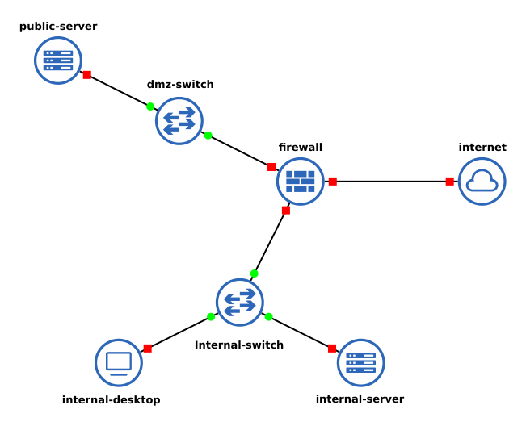
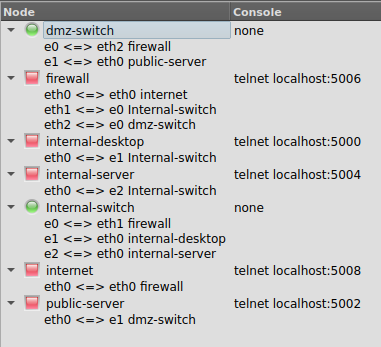
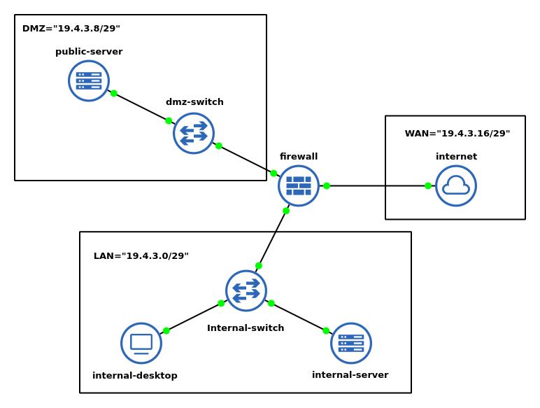
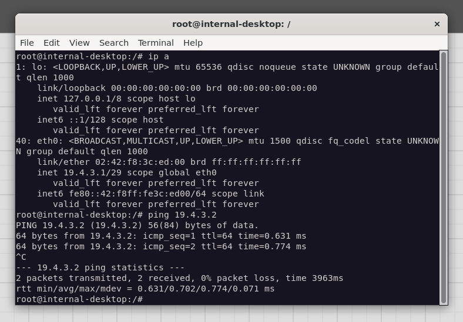
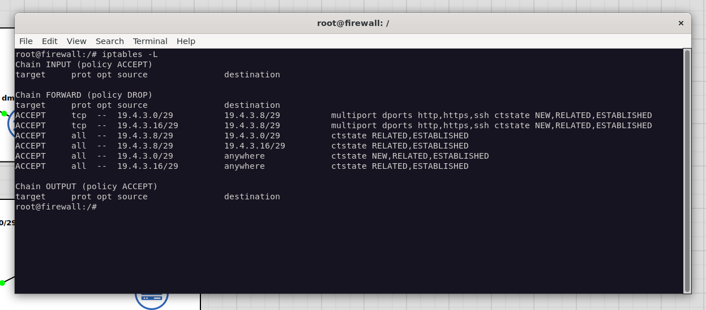
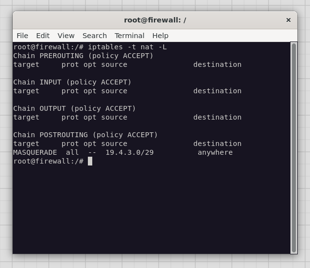
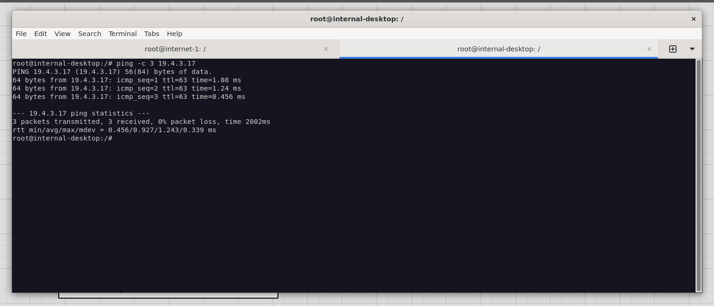
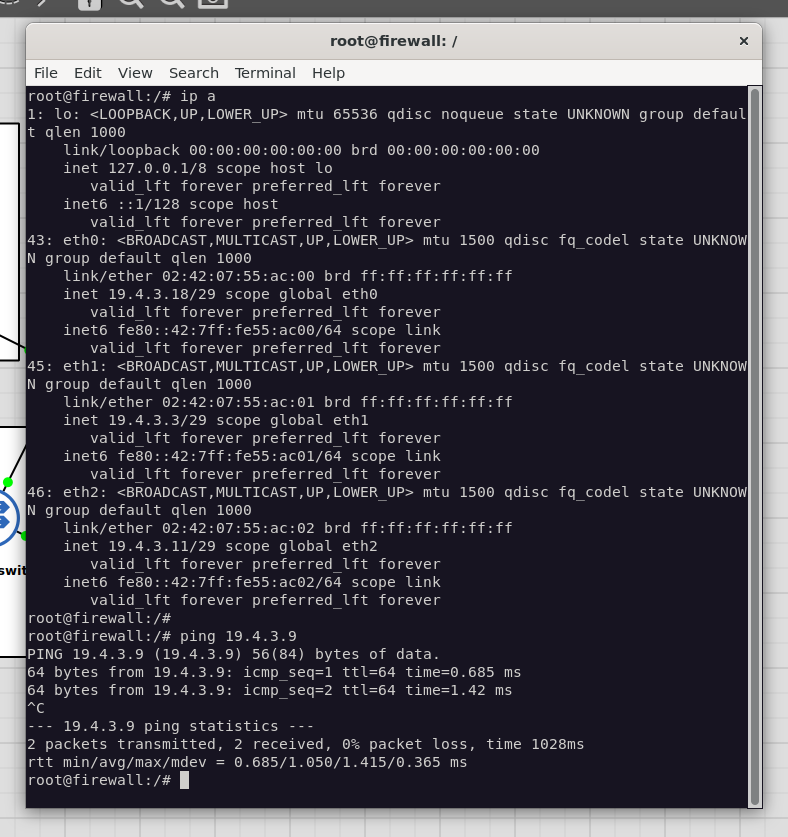

# Rapport : Mise en place d’une architecture DMZ via GNS3 et Docker

## Membres du groupe :
  - 1979
  - 2075

## Introduction

L’objectif de ce travail pratique est de mettre en œuvre une architecture réseau sécurisée intégrant une zone
démilitarisée (DMZ), en utilisant les outils GNS3 et Docker. Ce projet s’inscrit dans le cadre de l’apprentissage des
techniques de défense périmétrique d’un système d’information. Il permet de concevoir, configurer et
analyser une topologie réseau complète, comprenant la mise en place d’une DMZ, la gestion des règles de filtrage et de
NAT, le déploiement de solutions de détection/prévention d’intrusion ainsi que l’analyse des logs pour valider la
politique de sécurité. À travers la réalisation de ce TP, les compétences en conception d’architectures sécurisées, en
administration réseau et en cybersécurité seront renforcées.

## Méthodologie

La méthodologie suivie pour la réalisation de ce travail pratique s’articule autour des étapes suivantes

### 1. **Création des images Docker**

La première étape a consisté à créer les images Docker nécessaires pour simuler l'ensemble des machines de notre architecture DMZ. Plusieurs Dockerfiles ont été développés, chacun correspondant à un rôle spécifique dans l'infrastructure :

#### 1.1 Client LAN (`ubuntu_client`)

Cette image simule une machine cliente dans le réseau LAN interne de l'entreprise :

```dockerfile
FROM ubuntu:20.04

ENV DEBIAN_FRONTEND=noninteractive

RUN apt-get update && apt-get install -y \
    lynx \
    iputils-ping \
    traceroute \
    curl \
    wget \
    nano \
    openssh-client \
    iproute2 \
    dnsutils
```

**Rôle** : Machine cliente utilisée pour tester l'accès depuis le LAN vers la DMZ et Internet, et valider les règles de filtrage du pare-feu.

#### 1.2 Pare-feu (`ubuntu_firewall`)

Cette image centralise toutes les fonctions de sécurité réseau :

```dockerfile
FROM ubuntu:20.04

ENV DEBIAN_FRONTEND=noninteractive

RUN apt-get update && apt-get install -y \
    iptables \
    iproute2 \
    tcpdump \
    squid \
    squidguard \
    squid-cgi \
    apache2-utils \
    dnsutils \
    dnsmasq \
    iputils-ping \
    curl \
    wget \
    nano \
    iftop \
    tcptrack \
    wondershaper \
    cron
```

**Rôle** : Pare-feu principal avec filtrage de paquets (iptables), proxy web (Squid), filtrage de contenu (SquidGuard) et outils de monitoring réseau.

#### 1.3 Serveur Web DMZ (`ubuntu_webserver`)

Cette image héberge le serveur web situé dans la DMZ et intègre des outils de supervision et de sécurité :

```dockerfile
FROM ubuntu:20.04

ENV DEBIAN_FRONTEND=noninteractive

RUN apt-get update && apt-get install -y \
    apache2 \
    lynx \
    iputils-ping \
    traceroute \
    curl \
    wget \
    nano \
    openssh-client \
    openssh-server \
    iproute2 \
    dnsutils \
    apache2-utils \
    tcpdump \
    net-tools \
    snort 
```

**Rôle** : Serveur web Apache situé dans la DMZ, accessible depuis Internet mais isolé du réseau LAN interne. Il intègre également des outils de supervision (`tcpdump`, `net-tools`) et un IDS (`snort`) pour la détection d'intrusions.

#### 1.4 Serveur Web LAN (`ubuntu_lan_webserver`)

Cette image simule un serveur web interne au LAN :

```dockerfile
FROM ubuntu:20.04

ENV DEBIAN_FRONTEND=noninteractive

RUN apt-get update && apt-get install -y \
    apache2 \
    lynx \
    iputils-ping \
    traceroute \
    curl \
    wget \
    nano \
    openssh-client \
    iproute2 \
    dnsutils \
    apache2-utils
```

**Rôle** : Serveur web interne au LAN, utilisé pour tester l'accès et l'isolation entre le LAN et la DMZ/WAN.

#### 1.5 WAN (`ubuntu_wan`)

Cette image simule une machine externe sur Internet :

```dockerfile
FROM ubuntu:20.04

ENV DEBIAN_FRONTEND=noninteractive

RUN apt-get update && apt-get install -y \
    hping3 \
    lynx \
    iputils-ping \
    traceroute \
    curl \
    wget \
    nano \
    openssh-client \
    iproute2 \
    apache2 \
    dnsutils \
    tcpdump
```

**Rôle** : Machine externe utilisée pour simuler des connexions depuis Internet et tester les règles de sécurité.

Toutes ces images utilisent Ubuntu 20.04 comme base et incluent la variable d'environnement `DEBIAN_FRONTEND=noninteractive` pour automatiser l'installation des paquets sans interaction utilisateur.

### 2.  **Mise en place de la topologie**

#### 2.1 **Création des containers dockers dans gns3**
##### firewall
- docker image : ubuntu_firewall
- interfaces : 3
- console : telnet

##### public-server
  - docker image : ubuntu_webserver
  - interfaces : 1
  - console : telnet

##### internal-server
  - docker image : ubuntu_lan_webserver
  - interfaces : 1
  - console : telnet

##### internal-desktop
  - docker image : ubuntu_client
  - interfaces : 1
  - console : telnet

##### internet
  - docker image : ubuntu_wan
  - interfaces : 1
  - console : telnet

#### 2.2 **Mise en place de la topologie dans gns3**

##### 1. Instanciation et liaison des containers

On commence par instancier les containers et les relier comme dans la figure ci-dessous :



**Structure réseau :**

- **dmz-switch**
  - e0 ←→ eth2 firewall
  - e1 ←→ eth0 public-server

- **firewall**
  - eth0 ←→ e0 internal-switch
  - eth1 ←→ e0 internal-switch
  - eth2 ←→ e1 dmz-switch

- **internal-desktop**
  - eth0 ←→ e1 internal-switch

- **internal-server**
  - eth0 ←→ e2 internal-switch

- **internal-switch**
  - e0 ←→ eth1 firewall
  - e1 ←→ eth0 internal-desktop
  - e2 ←→ eth0 internal-server

- **internet**
  - eth0 ←→ eth0 firewall

- **public-server**
  - eth0 ←→ e1 dmz-switch

###### Image de la liaison des noeuds :


##### 2. Démarrage et configuration des adresses IP

Après le démarrage de toutes les instances, on configure leurs adresses IP comme suit :

###### a) LAN
- **internal-desktop**
  ```bash
  ip a add 19.4.3.1/29 dev eth0
  ip route add default via 19.4.3.3 dev eth0
  echo "nameserver 19.4.3.3" > /etc/resolv.conf
  ```
- **internal-server**
  ```bash
  ip a add 19.4.3.2/29 dev eth0
  ip route add default via 19.4.3.3 dev eth0
  echo "nameserver 19.4.3.3" > /etc/resolv.conf
  ```

###### b) WAN
- **internet**
  ```bash
  ip a add 19.4.3.17/29 dev eth0
  ip route add default via 19.4.3.18 dev eth0
  ```

###### c) DMZ
- **public-server (DMZ)**
  ```bash
  ip a add 19.4.3.9/29 dev eth0
  ip route add default via 19.4.3.11 dev eth0
  ```

###### d) Pare-feu
- **firewall**
  ```bash
  ip a add 19.4.3.3/29 dev eth1
  ip a add 19.4.3.11/29 dev eth2
  ip a add 19.4.3.18/29 dev eth0
  sysctl -w net.ipv4.ip_forward=1
  ```

###### Subnets utilisés
```bash
WAN="19.4.3.16/29"
LAN="19.4.3.0/29"
DMZ="19.4.3.8/29"
```

###### Image de la topologie :



#### 2.3. Test de la topologie de base
###### 1. LAN <-> LAN
- **internal-desktop -> internal-server**
 ```bash
  ping 19.4.3.2
  ```

- **internal-server -> internal-desktop**
```bash
  ping 19.4.3.1
  ```

###### 2. firewall <-> LAN
- **firewall -> internal-desktop**
 ```bash
  ping 19.4.3.1
  ```

- **firewall -> internal-server**
 ```bash
  ping 19.4.3.2
  ```

- **internal-server -> firewall**
 ```bash
  ping 19.4.3.3
  ```

- **internal-desktop -> firewall**
 ```bash
  ping 19.4.3.3
  ```

###### 3. firewall <-> WAN
- **firewall -> internet**
 ```bash
  ping 19.4.3.17
  ```

- **internet -> firewall**
 ```bash
  ping 19.4.3.18
  ```

###### 4. firewall <-> DMZ
- **firewall -> DMZ**
 ```bash
  ping 19.4.3.9
  ```

- **DMZ -> firewall**
 ```bash
  ping 19.4.3.11
  ```

###### 5. DMZ <-> LAN
- **LAN -> DMZ**
 ```bash
  ping 19.4.3.9
  ```

- **DMZ -> LAN**
 ```bash
  ping 19.4.3.1
  ping 19.4.3.2
  ```

###### 6. WAN <-> DMZ
- **WAN -> DMZ**
 ```bash
  ping 19.4.3.9
  ```
- **DMZ -> WAN**
 ```bash
  ping 19.4.3.17
  ```

#### 3. Configuration des servers
###### 3.1 public-server
 ```bash
echo "ServerName localhost" | tee /etc/apache2/conf-available/servername.conf
a2enconf servername
service apache2 restart

cd /var/www/html/

echo "<html>
<head>
    <title>Serveur Apache dans Docker DMZ</title>
</head>
<body>
    <h1>Bienvenue sur le serveur publique</h1>
</body>
</html>" > /var/www/html/index.html

a2enmod ssl
a2enmod rewrite

mkdir -p /etc/ssl/private
mkdir -p /etc/ssl/certs

openssl req -x509 -nodes -days 365 -newkey rsa:2048 \
    -keyout /etc/ssl/private/apache-selfsigned.key \
    -out /etc/ssl/certs/apache-selfsigned.crt \
    -subj "/C=FR/ST=State/L=City/O=Organization/OU=OrgUnit/CN=webserver"

cat > /etc/apache2/sites-available/default-ssl.conf << 'EOF'
<IfModule mod_ssl.c>
    <VirtualHost *:443>
        DocumentRoot /var/www/html
        
        SSLEngine on
        SSLCertificateFile /etc/ssl/certs/apache-selfsigned.crt
        SSLCertificateKeyFile /etc/ssl/private/apache-selfsigned.key
        
        <FilesMatch "\.(cgi|shtml|phtml|php)$">
            SSLOptions +StdEnvVars
        </FilesMatch>
    </VirtualHost>
</IfModule>
EOF

a2ensite default-ssl

service apache2 restart

mkdir -p /var/run/sshd
ssh-keygen -A
echo "PasswordAuthentication yes" >> /etc/ssh/sshd_config
echo "PermitRootLogin yes" >> /etc/ssh/sshd_config
useradd -m -s /bin/bash user
echo "user:root" | chpasswd
service ssh start

  ```

###### 3.2 internal-server
 ```bash
  echo "ServerName localhost" | tee /etc/apache2/conf-available/servername.conf
  a2enconf servername
  service apache2 restart

  cd /var/www/html/

  echo "<html>
  <head>
      <title>Serveur Apache dans Docker Interne</title>
  </head>
  <body>
      <h1>Bienvenue sur le serveur interne</h1>
  </body>
  </html>" > /var/www/html/index.html

  ```
###### 3.3 internet

```bash
echo "ServerName localhost" | tee /etc/apache2/conf-available/servername.conf
a2enconf servername
service apache2 restart

cd /var/www/html/

echo "<html>
<head>
    <title>Mon serveur Apache dans Docker du WAN</title>
</head>
<body>
    <h1>Bienvenue sur le WAN</h1>
</body>
</html>" > /var/www/html/index.html

```

### 3.  **Configuration des services et comportements attendus**
#### 3.1. **Pare-feu**
On definit tout d'abors les varables à utiliser :
 ```bash
  WAN="19.4.3.16/29"
  LAN="19.4.3.0/29"
  DMZ="19.4.3.8/29"
  HTTP="80"
  HTTPS="443"
  SSH="22"

  WAN_IFACE="eth0"
  LAN_IFACE="eth1"
  DMZ_IFACE="eth2"
  ```

Etant donné qu'on a crée l'image docker à partir d'une image **ubuntu vierge** et qu'on a **nous meme installé les packets necessaires**, **``iptables`` ne contient encore aucune regle**.

##### - Autoriser HTTP, HTTPS, SSH vers la DMZ (depuis WAN et LAN)
 ```bash
  iptables -A FORWARD -p tcp -s $LAN,$WAN -d $DMZ -m multiport --dports $HTTP,$HTTPS,$SSH -m conntrack --ctstate NEW,ESTABLISHED,RELATED -j ACCEPT
  iptables -A FORWARD -s $DMZ -d $LAN,$WAN -m conntrack --ctstate ESTABLISHED,RELATED -j ACCEPT
  ```



##### -  Bloquer tout autre port ou protocole par défaut
 ```bash
  iptables -P FORWARD DROP
  ```



##### -  Bloquer l’accès du WAN vers le LAN
Déja inclut avec :
 ```bash
  iptables -P FORWARD DROP
  ```

##### - Autoriser le LAN à sortir vers l’extérieur via NAT
 ```bash
  iptables -t nat -A POSTROUTING -s $LAN -o $WAN_IFACE -j MASQUERADE
  iptables -A FORWARD -s $LAN -o $WAN_IFACE -m conntrack --ctstate NEW,ESTABLISHED,RELATED -j ACCEPT
  iptables -A FORWARD -s $WAN -i $WAN_IFACE -m conntrack --ctstate ESTABLISHED,RELATED -j ACCEPT
  ```

- ping depuis LAN vers WAN : 
  - 
- affichage des packets dans internet :
  - 

##### - Mise en place d'un serveur DNS (Dnsmasq)

Pour simplifier la résolution de noms dans notre topologie, nous allons configurer `dnsmasq` sur le pare-feu. Ce service agira comme un serveur DNS pour le LAN, résolvant les noms de domaine de notre réseau local et transférant les autres requêtes à des serveurs DNS externes (simulés ou réels).

###### 1. Configuration de Dnsmasq

Créez un fichier de configuration pour `dnsmasq` sur le pare-feu. Nous allons le configurer pour qu'il écoute uniquement sur l'interface du LAN et utilise le fichier `/etc/hosts` du pare-feu comme source pour les noms locaux.

```bash
# Sur le pare-feu
cat > /etc/dnsmasq.conf << 'EOF'
# Écouter uniquement sur l'interface LAN
interface=eth1
# Ne pas lire /etc/resolv.conf pour les serveurs DNS amont
no-resolv
# Utiliser le serveur DNS de Google comme serveur amont (simulé)
server=8.8.8.8
# Ajouter les noms du fichier hosts local au DNS
expand-hosts
# Domaine pour les requêtes locales
domain=lan.local
EOF
```

###### 2. Ajout d'entrées DNS locales

Pour que notre test de filtrage fonctionne sans modifier le fichier `/etc/hosts` de chaque client, nous pouvons ajouter l'entrée directement dans le fichier `/etc/hosts` du pare-feu. `dnsmasq` le servira ensuite à tout le LAN.

```bash
# Sur le pare-feu
echo "19.4.3.17 pornhub.com" >> /etc/hosts
```
###### 3. Démarrage du service

```bash
# Sur le pare-feu
service dnsmasq start
```

###### 4. Configuration des clients DNS

Nous avons déjà mis à jour la configuration des machines du LAN à l'étape 2.2 pour qu'elles utilisent le pare-feu (`19.4.3.3`) comme serveur DNS.

###### 5. Test de la résolution DNS

Depuis `internal-desktop`, vous pouvez maintenant utiliser `nslookup` ou `dig` pour vérifier que la résolution de noms fonctionne.

```bash
# Sur internal-desktop
nslookup pornhub.com
```

La réponse devrait être `19.4.3.17`.


##### - Bloquer les sites pornographiques (SquidGuard)

Pour bloquer l'accès à des sites spécifiques, nous utiliserons Squid comme proxy transparent et SquidGuard comme filtre d'URL. Le trafic HTTP du LAN sera redirigé vers Squid, qui le passera à SquidGuard pour inspection.

###### 1. Création d'un fichier de configuration personnalisé pour Squid

Pour éviter les conflits avec la configuration par défaut, nous allons créer un fichier séparé qui contiendra nos directives. Squid lira ce fichier et appliquera nos règles.

Créez le fichier `/etc/squid/conf.d/00-custom.conf` sur le pare-feu :

```bash
cat >/etc/squid/conf.d/00-custom.conf<< 'EOF'
http_port 3128 intercept

http_port 127.0.0.1:3129

# Définir une ACL pour notre réseau local (LAN)
acl localnet src 19.4.3.0/29

# Autoriser l'accès pour notre réseau local
# Cette règle doit être placée avant les règles "deny" par défaut
http_access allow localnet

# Spécifier le programme de réécriture d'URL (SquidGuard)
url_rewrite_program /usr/bin/squidGuard -c /etc/squidguard/squidGuard.conf

# Nombre de processus SquidGuard à lancer
url_rewrite_children 5
EOF
```

###### 2. Configuration de SquidGuard

Créez et configurez le fichier `/etc/squidguard/squidGuard.conf` pour définir les listes de blocage.

```bash
cat >/etc/squidguard/squidGuard.conf<< 'EOF'
# Emplacement des bases de données de listes noires
dbhome /var/lib/squidguard/db

# Emplacement des fichiers de log
logdir /var/log/squid

# Définir la source (notre LAN)
src lan {
    ip 19.4.3.0/29
}

# Définir la destination (catégorie "porn")
dest porn {
    domainlist porn/domains
    urllist porn/urls
}

# Définir la politique de contrôle d'accès (ACL)
acl {
    lan {
        pass !porn all
        redirect http://19.4.3.3/cgi-bin/squidGuard.cgi?clientaddr=%a&clientname=%n&clientuser=%i&clientgroup=%s&targetgroup=%t&url=%u
    }
    default {
        pass none
        redirect http://19.4.3.3/cgi-bin/squidGuard.cgi?clientaddr=%a&clientname=%n&clientuser=%i&clientgroup=%s&targetgroup=%t&url=%u
    }
}
EOF
```

###### 3. Création de la liste noire

Nous devons créer les fichiers contenant les domaines et URL à bloquer.

```bash
# Créer les répertoires nécessaires
mkdir -p /var/lib/squidguard/db/porn

# Créer le fichier de domaines à bloquer
cat > /var/lib/squidguard/db/porn/domains << 'EOF'
pornhub.com
xvideos.com
xnxx.com
redtube.com
youporn.com
EOF

# Créer un fichier d'URLs (même si vide pour l'instant)
touch /var/lib/squidguard/db/porn/urls
```

###### 4. Redirection du trafic avec iptables

Ajoutez une règle `iptables` sur le pare-feu pour rediriger tout le trafic HTTP (port 80) provenant du LAN vers le port de Squid (3128).

```bash
# Rediriger le trafic HTTP du LAN vers Squid
iptables -t nat -A PREROUTING -i $LAN_IFACE -p tcp --dport 80 -j REDIRECT --to-port 3128
```

###### 5. Finalisation de la configuration

Compilez la base de données de SquidGuard, ajustez les permissions et redémarrez les services.

```bash
# Compiler la base de données de la liste noire
squidGuard -b -d -C all

# Donner les permissions correctes aux répertoires
chown -R proxy:proxy /var/lib/squidguard/db
chown -R proxy:proxy /var/log/squid
chmod -R 755 /var/lib/squidguard/db

# Redémarrer Squid pour appliquer les changements
service squid restart
```

###### 5.1 Vérification de la configuration

Avant de redémarrer Squid, il est crucial de vérifier que les fichiers de configuration ne contiennent pas d'erreurs de syntaxe.

```bash
# Vérifier la syntaxe du fichier de configuration de Squid
squid -k parse
```

Si cette commande ne retourne aucune erreur, vous pouvez continuer. Sinon, vous devrez corriger les erreurs indiquées dans `squid.conf` avant de poursuivre.

###### 5.2 Vérification de SquidGuard

Si la configuration de Squid est valide mais que le service ne démarre toujours pas, le problème vient probablement de SquidGuard. Voici comment le diagnostiquer.

```bash
# 1. Vérifiez les permissions des listes noires
# Cette commande doit être exécutée après la création des listes.
chown -R proxy:proxy /var/lib/squidguard/db
chmod -R 755 /var/lib/squidguard/db

# 2. Compilez la base de données et vérifiez les erreurs
# L'option -d active le mode debug pour voir les erreurs de syntaxe.
squidGuard -b -d -C all
```

###### 6. Test du filtrage

Dans notre topologie simulée, les machines du LAN n'ont pas accès à un serveur DNS public pour résoudre les noms de domaine comme `pornhub.com`. Pour pouvoir tester notre configuration, nous avons deja utilisé `dnsmasq`.
Il ne nous reste plus qu'à executer la commande :
```bash
curl http://pornhub.com
```
La connexion devrait être refusée ou redirigée, confirmant que le filtrage avec SquidGuard est fonctionnel.

