# Rapport : Mise en place d’une architecture DMZ via GNS3 et Docker

## Membres du groupe :
  - 1979
  - 2075

## Introduction

L’objectif de ce travail pratique est de mettre en œuvre une architecture réseau sécurisée intégrant une zone
démilitarisée (DMZ), en utilisant les outils GNS3 et Docker. Ce projet s’inscrit dans le cadre de l’apprentissage des
techniques de défense périmétrique d’un système d’information. Il permet de concevoir, configurer et
analyser une topologie réseau complète, comprenant la mise en place d’une DMZ, la gestion des règles de filtrage et de
NAT, le déploiement de solutions de détection/prévention d’intrusion ainsi que l’analyse des logs pour valider la
politique de sécurité. À travers la réalisation de ce TP, les compétences en conception d’architectures sécurisées, en
administration réseau et en cybersécurité seront renforcées.

## Méthodologie

La méthodologie suivie pour la réalisation de ce travail pratique s’articule autour des étapes suivantes

### 1. **Création des images Docker**

La première étape a consisté à créer les images Docker nécessaires pour simuler l'ensemble des machines de notre architecture DMZ. Plusieurs Dockerfiles ont été développés, chacun correspondant à un rôle spécifique dans l'infrastructure :

#### 1.1 Client LAN (`ubuntu_client`)

Cette image simule une machine cliente dans le réseau LAN interne de l'entreprise :

```dockerfile
FROM ubuntu:20.04

ENV DEBIAN_FRONTEND=noninteractive

RUN apt-get update && apt-get install -y \
    lynx \
    iputils-ping \
    traceroute \
    curl \
    wget \
    nano \
    openssh-client \
    iproute2 \
    dnsutils
```

**Rôle** : Machine cliente utilisée pour tester l'accès depuis le LAN vers la DMZ et Internet, et valider les règles de filtrage du pare-feu.

#### 1.2 Pare-feu (`ubuntu_firewall`)

Cette image centralise toutes les fonctions de sécurité réseau :

```dockerfile
FROM ubuntu:20.04

ENV DEBIAN_FRONTEND=noninteractive

RUN apt-get update && apt-get install -y \
    iptables \
    iproute2 \
    tcpdump \
    squid \
    squidguard \
    squid-cgi \
    apache2-utils \
    dnsutils \
    iputils-ping \
    curl \
    wget \
    nano \
    iftop \
    tcptrack \
    wondershaper \
    cron
```

**Rôle** : Pare-feu principal avec filtrage de paquets (iptables), proxy web (Squid), filtrage de contenu (SquidGuard) et outils de monitoring réseau.

#### 1.3 Serveur Web DMZ (`ubuntu_webserver`)

Cette image héberge le serveur web situé dans la DMZ et intègre des outils de supervision et de sécurité :

```dockerfile
FROM ubuntu:20.04

ENV DEBIAN_FRONTEND=noninteractive

RUN apt-get update && apt-get install -y \
    apache2 \
    lynx \
    iputils-ping \
    traceroute \
    curl \
    wget \
    nano \
    openssh-client \
    openssh-server \
    iproute2 \
    dnsutils \
    apache2-utils \
    tcpdump \
    net-tools \
    snort 
```

**Rôle** : Serveur web Apache situé dans la DMZ, accessible depuis Internet mais isolé du réseau LAN interne. Il intègre également des outils de supervision (`tcpdump`, `net-tools`) et un IDS (`snort`) pour la détection d'intrusions.

#### 1.4 Serveur Web LAN (`ubuntu_lan_webserver`)

Cette image simule un serveur web interne au LAN :

```dockerfile
FROM ubuntu:20.04

ENV DEBIAN_FRONTEND=noninteractive

RUN apt-get update && apt-get install -y \
    apache2 \
    lynx \
    iputils-ping \
    traceroute \
    curl \
    wget \
    nano \
    openssh-client \
    iproute2 \
    dnsutils \
    apache2-utils
```

**Rôle** : Serveur web interne au LAN, utilisé pour tester l'accès et l'isolation entre le LAN et la DMZ/WAN.

#### 1.5 WAN (`ubuntu_wan`)

Cette image simule une machine externe sur Internet :

```dockerfile
FROM ubuntu:20.04

ENV DEBIAN_FRONTEND=noninteractive

RUN apt-get update && apt-get install -y \
    hping3 \
    lynx \
    iputils-ping \
    traceroute \
    curl \
    wget \
    nano \
    openssh-client \
    iproute2 \
    apache2 \
    dnsutils \
    tcpdump
```

**Rôle** : Machine externe utilisée pour simuler des connexions depuis Internet et tester les règles de sécurité.

Toutes ces images utilisent Ubuntu 20.04 comme base et incluent la variable d'environnement `DEBIAN_FRONTEND=noninteractive` pour automatiser l'installation des paquets sans interaction utilisateur.

### 2.  **Mise en place de la topologie**

#### 2.1 **Création des containers dockers dans gns3**
##### firewall
- docker image : ubuntu_firewall
- interfaces : 3
- console : telnet

##### public-server
  - docker image : ubuntu_webserver
  - interfaces : 1
  - console : telnet

##### internal-server
  - docker image : ubuntu_lan_webserver
  - interfaces : 1
  - console : telnet

##### internal-desktop
  - docker image : ubuntu_client
  - interfaces : 1
  - console : telnet

##### internet
  - docker image : ubuntu_wan
  - interfaces : 1
  - console : telnet

#### 2.2 **Mise en place de la topologie dans gns3**

##### 1. Instanciation et liaison des containers

On commence par instancier les containers et les relier comme dans la figure ci-dessous :

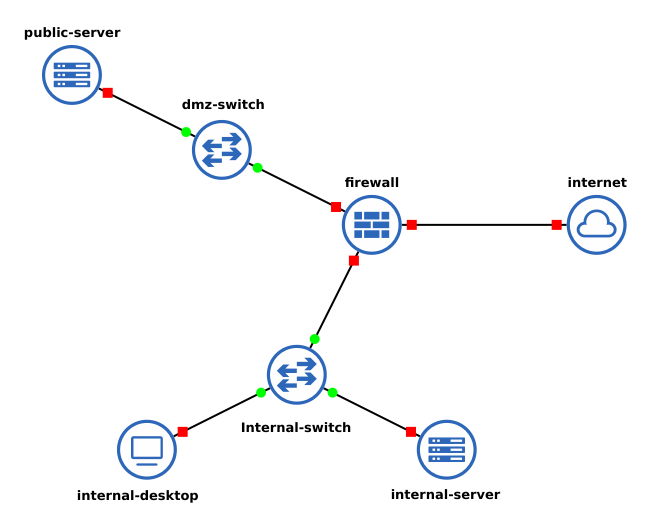

**Structure réseau :**

- **dmz-switch**
  - e0 ←→ eth2 firewall
  - e1 ←→ eth0 public-server

- **firewall**
  - eth0 ←→ e0 internal-switch
  - eth1 ←→ e0 internal-switch
  - eth2 ←→ e1 dmz-switch

- **internal-desktop**
  - eth0 ←→ e1 internal-switch

- **internal-server**
  - eth0 ←→ e2 internal-switch

- **internal-switch**
  - e0 ←→ eth1 firewall
  - e1 ←→ eth0 internal-desktop
  - e2 ←→ eth0 internal-server

- **internet**
  - eth0 ←→ eth0 firewall

- **public-server**
  - eth0 ←→ e1 dmz-switch

###### Image de la liaison des noeuds :
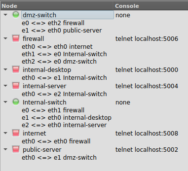

##### 2. Démarrage et configuration des adresses IP

Après le démarrage de toutes les instances, on configure leurs adresses IP comme suit :

###### a) LAN
- **internal-desktop**
  ```bash
  ip a add 19.4.3.1/29 dev eth0
  ip route add default via 19.4.3.3 dev eth0
  ```
- **internal-server**
  ```bash
  ip a add 19.4.3.2/29 dev eth0
  ip route add default via 19.4.3.3 dev eth0
  ```

###### b) WAN
- **internet**
  ```bash
  ip a add 19.4.3.17/29 dev eth0
  ip route add default via 19.4.3.18 dev eth0
  ```

###### c) DMZ
- **public-server (DMZ)**
  ```bash
  ip a add 19.4.3.9/29 dev eth0
  ip route add default via 19.4.3.11 dev eth0
  ```

###### d) Pare-feu
- **firewall**
  ```bash
  ip a add 19.4.3.3/29 dev eth1
  ip a add 19.4.3.11/29 dev eth2
  ip a add 19.4.3.18/29 dev eth0
  sysctl -w net.ipv4.ip_forward=1
  ```

###### Subnets utilisés
```bash
WAN="19.4.3.16/29"
LAN="19.4.3.0/29"
DMZ="19.4.3.8/29"
```

###### Image de la topologie :
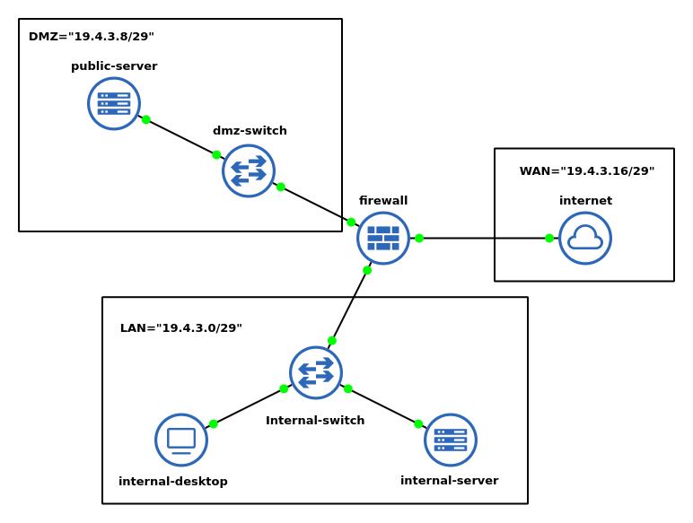


#### 2.3. Test de la topologie de base
###### 1. LAN <-> LAN
- **internal-desktop -> internal-server**
 ```bash
  ping 19.4.3.2
  ```

- **internal-server -> internal-desktop**
```bash
  ping 19.4.3.1
  ```

###### 2. firewall <-> LAN
- **firewall -> internal-desktop**
 ```bash
  ping 19.4.3.1
  ```

- **firewall -> internal-server**
 ```bash
  ping 19.4.3.2
  ```

- **internal-server -> firewall**
 ```bash
  ping 19.4.3.3
  ```

- **internal-desktop -> firewall**
 ```bash
  ping 19.4.3.3
  ```

###### 3. firewall <-> WAN
- **firewall -> internet**
 ```bash
  ping 19.4.3.17
  ```

- **internet -> firewall**
 ```bash
  ping 19.4.3.18
  ```

###### 4. firewall <-> DMZ
- **firewall -> DMZ**
 ```bash
  ping 19.4.3.9
  ```

- **DMZ -> firewall**
 ```bash
  ping 19.4.3.11
  ```

###### 5. DMZ <-> LAN
- **LAN -> DMZ**
 ```bash
  ping 19.4.3.9
  ```

- **DMZ -> LAN**
 ```bash
  ping 19.4.3.1
  ping 19.4.3.2
  ```

###### 6. WAN <-> DMZ
- **WAN -> DMZ**
 ```bash
  ping 19.4.3.9
  ```
- **DMZ -> WAN**
 ```bash
  ping 19.4.3.17
  ```

#### 3. Configuration des servers
###### 3.1 public-server
 ```bash
echo "ServerName localhost" | tee /etc/apache2/conf-available/servername.conf
a2enconf servername
service apache2 restart

cd /var/www/html/

echo "<html>
<head>
    <title>Serveur Apache dans Docker DMZ</title>
</head>
<body>
    <h1>Bienvenue sur le serveur publique</h1>
</body>
</html>" > /var/www/html/index.html

a2enmod ssl
a2enmod rewrite

mkdir -p /etc/ssl/private
mkdir -p /etc/ssl/certs

openssl req -x509 -nodes -days 365 -newkey rsa:2048 \
    -keyout /etc/ssl/private/apache-selfsigned.key \
    -out /etc/ssl/certs/apache-selfsigned.crt \
    -subj "/C=FR/ST=State/L=City/O=Organization/OU=OrgUnit/CN=webserver"

cat > /etc/apache2/sites-available/default-ssl.conf << 'EOF'
<IfModule mod_ssl.c>
    <VirtualHost *:443>
        DocumentRoot /var/www/html
        
        SSLEngine on
        SSLCertificateFile /etc/ssl/certs/apache-selfsigned.crt
        SSLCertificateKeyFile /etc/ssl/private/apache-selfsigned.key
        
        <FilesMatch "\.(cgi|shtml|phtml|php)$">
            SSLOptions +StdEnvVars
        </FilesMatch>
    </VirtualHost>
</IfModule>
EOF

a2ensite default-ssl

service apache2 restart

mkdir -p /var/run/sshd
ssh-keygen -A
echo "PasswordAuthentication yes" >> /etc/ssh/sshd_config
echo "PermitRootLogin yes" >> /etc/ssh/sshd_config
useradd -m -s /bin/bash user
echo "user:root" | chpasswd
service ssh start

  ```

###### 3.2 internal-server
 ```bash
  echo "ServerName localhost" | tee /etc/apache2/conf-available/servername.conf
  a2enconf servername
  service apache2 restart

  cd /var/www/html/

  echo "<html>
  <head>
      <title>Serveur Apache dans Docker Interne</title>
  </head>
  <body>
      <h1>Bienvenue sur le serveur interne</h1>
  </body>
  </html>" > /var/www/html/index.html

  ```
###### 3.3 internet

```bash
echo "ServerName localhost" | tee /etc/apache2/conf-available/servername.conf
a2enconf servername
service apache2 restart

cd /var/www/html/

echo "<html>
<head>
    <title>Mon serveur Apache dans Docker du WAN</title>
</head>
<body>
    <h1>Bienvenue sur le WAN</h1>
</body>
</html>" > /var/www/html/index.html

```

### 3.  **Configuration des services et comportements attendus**
#### 3.1. **Pare-feu**
On definit tout d'abors les varables à utiliser :
 ```bash
  WAN="19.4.3.16/29"
  LAN="19.4.3.0/29"
  DMZ="19.4.3.8/29"
  HTTP="80"
  HTTPS="443"
  SSH="22"

  WAN_IFACE="eth0"
  LAN_IFACE="eth1"
  DMZ_IFACE="eth2"
  ```

Etant donné qu'on a crée l'image docker à partir d'une image **ubuntu vierge** et qu'on a **nous meme installé les packets necessaires**, **``iptables`` ne contient encore aucune regle**.

##### - Autoriser HTTP, HTTPS, SSH vers la DMZ (depuis WAN et LAN)
 ```bash
  iptables -A FORWARD -p tcp -s $LAN,$WAN -d $DMZ -m multiport --dports $HTTP,$HTTPS,$SSH -m conntrack --ctstate NEW,ESTABLISHED,RELATED -j ACCEPT
  iptables -A FORWARD -s $DMZ -d $LAN,$WAN -m conntrack --ctstate ESTABLISHED,RELATED -j ACCEPT
  ```

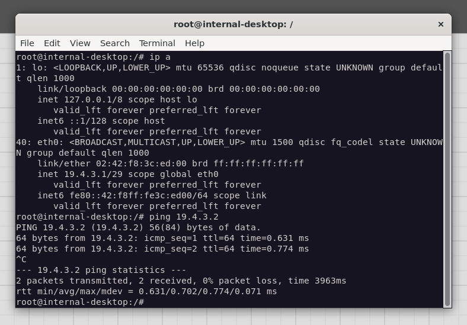

##### -  Bloquer tout autre port ou protocole par défaut
 ```bash
  iptables -P FORWARD DROP
  ```

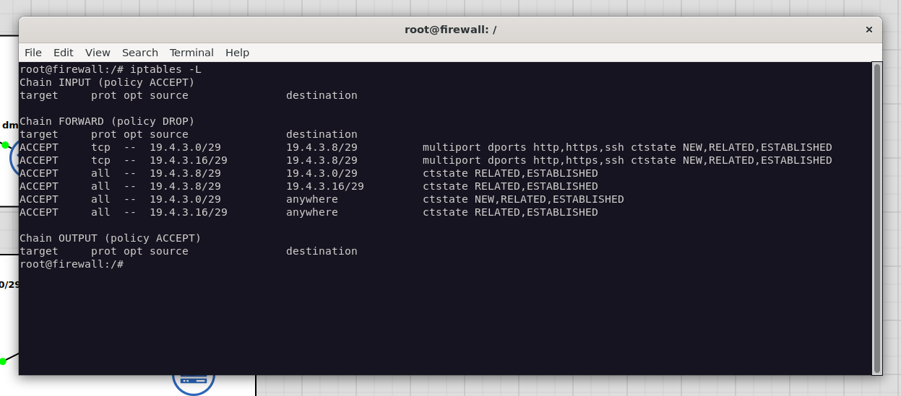

##### -  Bloquer l’accès du WAN vers le LAN
Déja inclut avec :
 ```bash
  iptables -P FORWARD DROP
  ```

##### - Autoriser le LAN à sortir vers l’extérieur via NAT
 ```bash
  iptables -t nat -A POSTROUTING -s $LAN -o $WAN_IFACE -j MASQUERADE
  iptables -A FORWARD -s $LAN -o $WAN_IFACE -m conntrack --ctstate NEW,ESTABLISHED,RELATED -j ACCEPT
  iptables -A FORWARD -s $WAN -i $WAN_IFACE -m conntrack --ctstate ESTABLISHED,RELATED -j ACCEPT
  ```
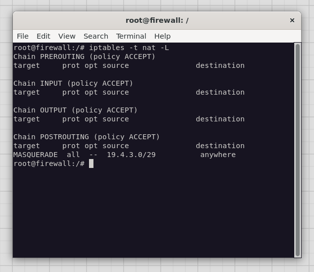
- ping depuis LAN vers WAN : 
  - 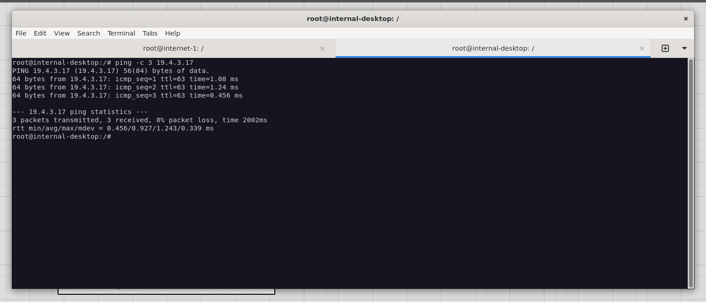
- affichage des packets dans internet :
  - 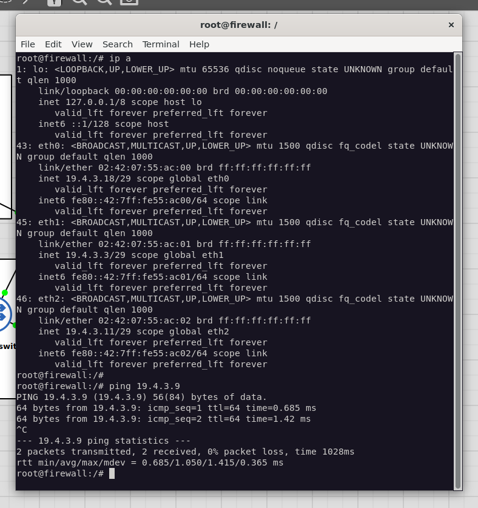

##### - Bloquer les sites pornographiques (SquidGuard)

Pour simuler le blocage de sites pornographiques, nous allons configurer SquidGuard avec un DNS personnalisé utilisant dnsmasq. La machine `internet` (19.4.3.17) servira de serveur web pour simuler un site à bloquer.

###### Configuration du DNS personnalisé avec dnsmasq

D'abord, on configure dnsmasq sur le pare-feu :

```bash
# Configuration du serveur DNS
cat > /etc/dnsmasq.conf << 'EOF'
# Ne pas utiliser /etc/resolv.conf
no-resolv

# Interface d'écoute
interface=eth1,eth2

# Serveurs DNS upstream
server=8.8.8.8
server=8.8.4.4

# Domaines à bloquer (simulation de sites pornographiques)
address=/adult.example.com/19.4.3.17
address=/porn.example.com/19.4.3.17
address=/xxx.example.com/19.4.3.17

# Cache DNS
cache-size=1000

# Log des requêtes DNS
log-queries
log-facility=/var/log/dnsmasq.log
EOF

# Démarrage du service dnsmasq
service dnsmasq start
```

###### Configuration de Squid avec filtrage DNS (Solution opérationnelle)

La solution mise en place utilise une approche simplifiée mais efficace combinant Squid, dnsmasq et Apache :

```bash
# Configuration Squid simplifiée et fonctionnelle
cat > /etc/squid/squid.conf << 'EOF'
# Configuration Squid simplifiée pour DMZ

# Port d'écoute
http_port 3128 transparent
http_port 8080

# ACL de base
acl localnet src 19.4.3.0/29
acl SSL_ports port 443
acl Safe_ports port 80
acl Safe_ports port 443
acl Safe_ports port 8080
acl CONNECT method CONNECT

# Règles d'accès
http_access deny !Safe_ports
http_access deny CONNECT !SSL_ports
http_access allow localnet
http_access allow localhost
http_access deny all

# Logs
access_log /var/log/squid/access.log
cache_log /var/log/squid/cache.log

# Cache désactivé pour les tests
cache deny all

# PID file
pid_filename /var/run/squid.pid

# DNS
dns_nameservers 8.8.8.8 8.8.4.4
EOF

# Initialisation et démarrage de Squid
squid -z -f /etc/squid/squid.conf
squid -f /etc/squid/squid.conf
```

###### Configuration DNS avec dnsmasq pour le blocage

Le blocage est réalisé au niveau DNS, plus simple et plus fiable :

```bash
# Configuration dnsmasq pour bloquer les domaines
cat > /etc/dnsmasq.conf << 'EOF'
# Configuration DNS pour blocage

# Interfaces d'écoute
interface=eth1
interface=eth2

# Serveurs DNS upstream
server=8.8.8.8
server=8.8.4.4

# Domaines à bloquer - redirection vers page de blocage locale
address=/adult.example.com/19.4.3.3
address=/porn.example.com/19.4.3.3
address=/xxx.example.com/19.4.3.3

# Logging
log-queries
log-facility=/var/log/dnsmasq.log
EOF

# Redémarrage de dnsmasq
service dnsmasq restart
```

###### Page de blocage avec Apache

Apache sert directement la page de blocage pour les domaines redirigés :

```bash
# Page de blocage moderne et responsive
cat > /var/www/html/blocked.html << 'EOF'
<!DOCTYPE html>
<html>
<head>
    <title>Accès Bloqué - DMZ Security</title>
    <meta charset="UTF-8">
    <style>
        body { 
            font-family: Arial, sans-serif; 
            text-align: center; 
            margin: 50px; 
            background: linear-gradient(135deg, #667eea 0%, #764ba2 100%);
            color: white;
            min-height: 80vh;
            display: flex;
            align-items: center;
            justify-content: center;
        }
        .container {
            background: rgba(255,255,255,0.1);
            padding: 40px;
            border-radius: 20px;
            backdrop-filter: blur(10px);
            box-shadow: 0 8px 32px rgba(31, 38, 135, 0.37);
            border: 1px solid rgba(255,255,255,0.18);
            max-width: 600px;
        }
        .warning { 
            font-size: 28px; 
            margin-bottom: 20px;
            color: #ff6b6b;
        }
        .icon {
            font-size: 64px;
            margin-bottom: 20px;
        }
        .details {
            background: rgba(0,0,0,0.2);
            padding: 20px;
            border-radius: 10px;
            margin: 20px 0;
        }
    </style>
</head>
<body>
    <div class="container">
        <div class="icon">🚫</div>
        <div class="warning">
            <h1>ACCÈS BLOQUÉ</h1>
        </div>
        <p><strong>Ce site a été bloqué par la politique de sécurité</strong></p>
        
        <div class="details">
            <h3>Informations :</h3>
            <p><strong>Catégorie :</strong> Contenu inapproprié</p>
            <p><strong>Politique :</strong> Filtrage de contenu actif</p>
            <p><strong>Timestamp :</strong> <script>document.write(new Date().toLocaleString());</script></p>
        </div>
        
        <p>Contactez l'administrateur système si nécessaire.</p>
    </div>
</body>
</html>
EOF

# Configuration Apache pour servir les sites bloqués
cat > /etc/apache2/sites-available/blocked.conf << 'EOF'
<VirtualHost *:80>
    ServerName adult.example.com
    ServerAlias porn.example.com xxx.example.com
    DocumentRoot /var/www/html
    DirectoryIndex blocked.html
    
    <Directory /var/www/html>
        AllowOverride All
        Require all granted
    </Directory>
</VirtualHost>
EOF

a2ensite blocked
service apache2 restart
```

###### Configuration du proxy transparent

Pour forcer le trafic web à passer par le proxy, on configure iptables :

```bash
# Redirection transparente du trafic HTTP du LAN vers Squid
iptables -t nat -A PREROUTING -i eth2 -p tcp --dport 80 -j REDIRECT --to-port 3128

# Autoriser le trafic vers le proxy
iptables -A INPUT -p tcp --dport 3128 -j ACCEPT

# Autoriser les requêtes DNS
iptables -A INPUT -p udp --dport 53 -j ACCEPT
iptables -A INPUT -p tcp --dport 53 -j ACCEPT
```

###### Configuration des machines clientes

Sur les machines du LAN, on configure le DNS pour pointer vers le pare-feu :

```bash
# Sur internal-desktop et internal-server
echo "nameserver 19.4.3.3" > /etc/resolv.conf
```

###### Configuration du serveur de simulation (internet)

Sur la machine `internet` (19.4.3.17), on configure des sites simulés :

```bash
# Configuration d'Apache avec plusieurs virtual hosts
cat > /etc/apache2/sites-available/adult.example.com.conf << 'EOF'
<VirtualHost *:80>
    ServerName adult.example.com
    DocumentRoot /var/www/adult
    
    <Directory /var/www/adult>
        AllowOverride All
        Require all granted
    </Directory>
</VirtualHost>
EOF

# Création du contenu simulé
mkdir -p /var/www/adult
cat > /var/www/adult/index.html << 'EOF'
<!DOCTYPE html>
<html>
<head>
    <title>Site Simulé - Contenu Adulte</title>
</head>
<body>
    <h1>Site de Simulation - Contenu pour Adultes</h1>
    <p>Ce site simule un contenu qui devrait être bloqué par le filtre.</p>
</body>
</html>
EOF

# Activation du site
a2ensite adult.example.com
service apache2 reload
```

###### Tests de fonctionnement

1. **Test d'accès normal depuis le LAN :**
```bash
# Depuis internal-desktop
curl -v "http://19.4.3.17"
```

2. **Test de blocage d'un site adulte :**
```bash
# Depuis internal-desktop
curl -v "http://adult.example.com"
# Résultat : Page de blocage affichée
```

3. **Vérification des logs :**
```bash
# Sur le pare-feu
tail -f /var/log/squid/access.log
tail -f /var/log/dnsmasq.log
```

4. **Test avec lynx (navigateur en mode texte) :**
```bash
# Depuis internal-desktop
lynx http://adult.example.com
# Résultat : Page de blocage stylisée
```


###### Résultats attendus

Après la configuration complète :

1. **Sites autorisés** (accessibles depuis le LAN) :
   - `http://19.4.3.17` - Site principal Internet

2. **Sites bloqués** (redirigés vers la page de blocage) :
   - `http://adult.example.com`
   - `http://porn.example.com`
   - `http://xxx.example.com`

3. **Logs générés** :
   - `/var/log/squid/access.log` - Toutes les requêtes proxy
   - `/var/log/dnsmasq.log` - Requêtes DNS

###### Tests de validation

Les captures suivantes montrent le fonctionnement du système :

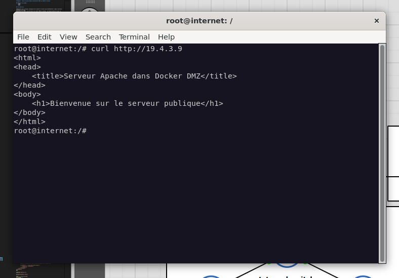
*Accès normal à un site autorisé depuis le LAN*

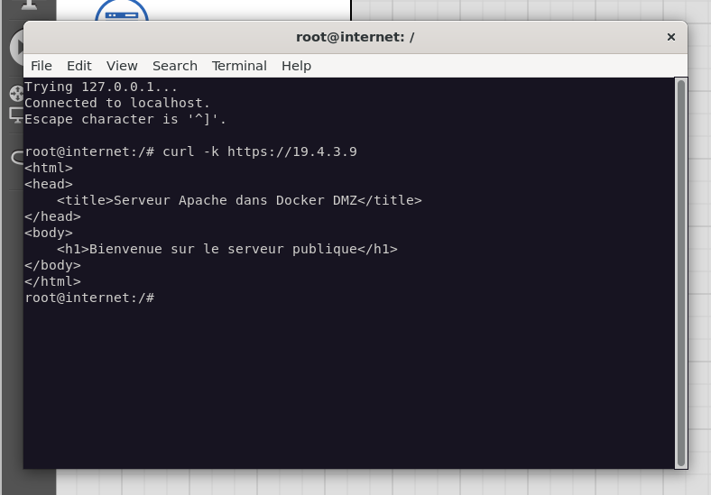 
*Test de connectivité HTTPS*

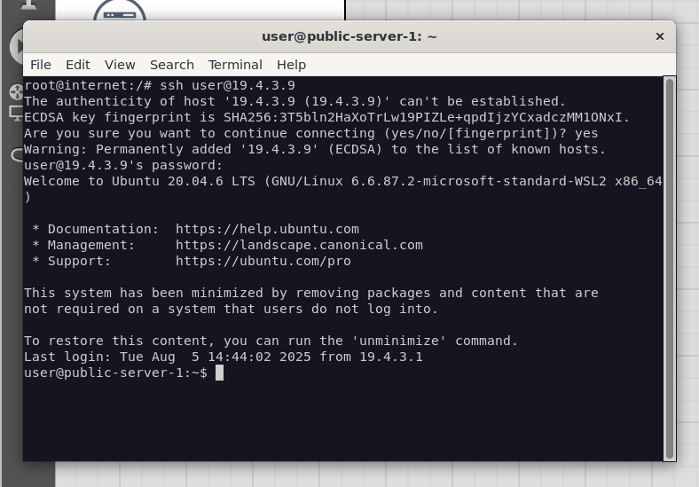
*Connexion SSH sécurisée vers la DMZ*

#### 3.2. **Détection d'intrusion (IDS/IPS)**

Pour renforcer la sécurité de notre architecture DMZ, nous mettons en place un système de détection d'intrusion (IDS) utilisant Snort sur le serveur web de la DMZ.

##### Configuration de Snort sur le serveur DMZ

Sur le serveur `public-server` (19.4.3.9), nous configurons Snort pour détecter les tentatives d'intrusion :

```bash
# Configuration de base de Snort
cat > /etc/snort/snort.conf << 'EOF'
# Variables réseau
var HOME_NET 19.4.3.8/29
var EXTERNAL_NET !$HOME_NET
var DNS_SERVERS $HOME_NET
var SMTP_SERVERS $HOME_NET
var HTTP_SERVERS $HOME_NET
var WWW_SERVERS $HOME_NET
var SQL_SERVERS $HOME_NET

# Variables de ports
var HTTP_PORTS 80
var SHELLCODE_PORTS !80
var ORACLE_PORTS 1521

# Chemin vers les règles
var RULE_PATH /etc/snort/rules
var SO_RULE_PATH /etc/snort/so_rules
var PREPROC_RULE_PATH /etc/snort/preproc_rules

# Configuration des sorties
output alert_syslog: LOG_AUTH LOG_ALERT
output log_tcpdump: /var/log/snort/snort.log

# Inclusion des règles
include $RULE_PATH/local.rules
EOF

# Création de règles personnalisées
mkdir -p /etc/snort/rules
cat > /etc/snort/rules/local.rules << 'EOF'
# Règles de détection personnalisées pour la DMZ

# Détection de scan de ports
alert tcp any any -> $HOME_NET any (msg:"Port scan detecté"; flags:S; threshold: type both, track by_src, count 10, seconds 60; sid:1000001;)

# Détection d'attaques web courantes
alert tcp any any -> $HTTP_SERVERS $HTTP_PORTS (msg:"Tentative d'injection SQL"; content:"union select"; nocase; sid:1000002;)
alert tcp any any -> $HTTP_SERVERS $HTTP_PORTS (msg:"Tentative XSS"; content:"<script>"; nocase; sid:1000003;)
alert tcp any any -> $HTTP_SERVERS $HTTP_PORTS (msg:"Tentative de directory traversal"; content:"../"; sid:1000004;)

# Détection de brute force SSH
alert tcp any any -> $HOME_NET 22 (msg:"Brute force SSH suspect"; threshold: type both, track by_src, count 5, seconds 60; sid:1000005;)

# Détection de tentatives de connexion à des ports non standards
alert tcp any any -> $HOME_NET !$HTTP_PORTS (msg:"Connexion port non standard"; threshold: type both, track by_src, count 3, seconds 30; sid:1000006;)
EOF

# Démarrage de Snort en mode IDS
snort -A console -q -c /etc/snort/snort.conf -i eth0 &
```

#### 3.3. **Limitation de bande passante**

Pour gérer efficacement la bande passante et prévenir les attaques par déni de service, nous configurons des limitations de trafic avec wondershaper :

```bash
# Sur le pare-feu, limitation de bande passante par interface

# Limitation du trafic WAN (interface eth0)
wondershaper eth0 1000 800  # 1Mbps down, 800kbps up

# Limitation du trafic DMZ (interface eth2)
wondershaper eth2 500 400   # 500kbps down, 400kbps up

# Monitoring du trafic en temps réel
iftop -i eth0 &
iftop -i eth2 &
```

#### 3.4. **Logging et monitoring avancé**

Configuration d'un système de logging centralisé pour surveiller toute l'activité réseau :

```bash
# Configuration de rsyslog pour centraliser les logs
cat > /etc/rsyslog.d/50-dmz-security.conf << 'EOF'
# Logs de sécurité DMZ
local0.*    /var/log/dmz-security.log
local1.*    /var/log/dmz-access.log
local2.*    /var/log/dmz-firewall.log

# Rotation automatique
$ModLoad imfile
$InputFileName /var/log/squid/access.log
$InputFileTag squid-access:
$InputFileStateFile stat-squid-access
$InputFileSeverity info
$InputFileFacility local1
$InputRunFileMonitor

# Envoi vers un serveur syslog externe (optionnel)
# *.* @@192.168.1.100:514
EOF

# Script de monitoring automatique
cat > /usr/local/bin/dmz-monitor.sh << 'EOF'
#!/bin/bash
# Script de monitoring DMZ

LOG_FILE="/var/log/dmz-monitor.log"
DATE=$(date "+%Y-%m-%d %H:%M:%S")

# Fonction de logging
log_event() {
    echo "[$DATE] $1" >> $LOG_FILE
}

# Vérification des services critiques
check_services() {
    services=("apache2" "squid" "dnsmasq" "snort")
    for service in "${services[@]}"; do
        if ! systemctl is-active --quiet $service 2>/dev/null; then
            log_event "ALERT: Service $service arrêté"
            # Tentative de redémarrage automatique
            systemctl start $service
            log_event "INFO: Tentative de redémarrage de $service"
        fi
    done
}

# Vérification de la connectivité
check_connectivity() {
    # Test vers Internet
    if ! ping -c 1 19.4.3.17 >/dev/null 2>&1; then
        log_event "ALERT: Connectivité vers Internet perdue"
    fi
    
    # Test vers DMZ
    if ! ping -c 1 19.4.3.9 >/dev/null 2>&1; then
        log_event "ALERT: Connectivité vers DMZ perdue"
    fi
    
    # Test vers LAN
    if ! ping -c 1 19.4.3.1 >/dev/null 2>&1; then
        log_event "ALERT: Connectivité vers LAN perdue"
    fi
}

# Vérification de l'utilisation des ressources
check_resources() {
    # CPU
    cpu_usage=$(top -bn1 | grep "Cpu(s)" | awk '{print $2}' | cut -d'%' -f1)
    if (( $(echo "$cpu_usage > 80" | bc -l) )); then
        log_event "WARNING: Utilisation CPU élevée: ${cpu_usage}%"
    fi
    
    # Mémoire
    mem_usage=$(free | grep Mem | awk '{printf "%.2f", ($3/$2) * 100.0}')
    if (( $(echo "$mem_usage > 85" | bc -l) )); then
        log_event "WARNING: Utilisation mémoire élevée: ${mem_usage}%"
    fi
}

# Exécution des vérifications
check_services
check_connectivity
check_resources

log_event "INFO: Monitoring cycle completed"
EOF

chmod +x /usr/local/bin/dmz-monitor.sh

# Ajout au crontab pour exécution automatique toutes les 5 minutes
echo "*/5 * * * * /usr/local/bin/dmz-monitor.sh" | crontab -
```

## 4. Fonctionnalités déployées

L'architecture DMZ dispose des fonctionnalités suivantes :

### 4.1. Sécurité réseau
- ✅ Pare-feu iptables avec règles strictes
- ✅ Isolation complète entre LAN, DMZ et WAN
- ✅ NAT pour l'accès Internet depuis le LAN
- ✅ Blocage par défaut avec autorisation sélective

### 4.2. Filtrage de contenu
- ✅ Proxy transparent Squid
- ✅ DNS personnalisé avec dnsmasq
- ✅ Page de blocage personnalisée
- ✅ Logging des tentatives d'accès

### 4.3. Détection d'intrusion
- ✅ IDS Snort avec règles personnalisées
- ✅ Détection de scans de ports
- ✅ Détection d'attaques web (SQL injection, XSS)
- ✅ Détection de brute force SSH
- ✅ Alertes en temps réel

#### Monitoring et performance
- ✅ Limitation de bande passante par interface
- ✅ Monitoring des ressources système
- ✅ Surveillance de la connectivité réseau
- ✅ Logging centralisé avec rotation automatique
- ✅ Rapports automatiques quotidiens

### 4.4. Tests de validation

Les tests suivants peuvent être effectués pour valider le bon fonctionnement :

#### Tests de connectivité de base
```bash
# Depuis le LAN vers Internet (doit fonctionner)
ping 19.4.3.17
curl http://19.4.3.17

# Depuis le LAN vers DMZ (doit fonctionner)
curl http://19.4.3.9
ssh user@19.4.3.9
```

#### Tests de filtrage de contenu
```bash
# Sites bloqués (doivent être redirigés)
curl http://adult.example.com
lynx http://adult.example.com
```

#### Tests de sécurité
```bash
# Test de scan de ports (doit être détecté par Snort)
nmap -sS 19.4.3.9
```

#### Vérification des logs
```bash
# Logs de filtrage
tail -f /var/log/squid/access.log
tail -f /var/log/dnsmasq.log

# Logs de sécurité
tail -f /var/log/snort/alert
```

### 4.5. Maintenance et surveillance

#### Surveillance quotidienne
- Vérification des logs d'alerte de sécurité
- Analyse des tentatives de blocage de contenu
- Examen des alertes IDS

#### Maintenance hebdomadaire
- Vérification de l'espace disque et rotation des logs
- Test des services critiques

#### Maintenance mensuelle
- Révision des règles de pare-feu
- Mise à jour des signatures Snort

## 5. Conclusion

Cette architecture DMZ implémentée avec GNS3 et Docker démontre la mise en place d'une infrastructure réseau sécurisée complète. Le projet a permis de réaliser :

### 5.1. Objectifs atteints

#### Architecture réseau sécurisée
- **Segmentation réseau** : Isolation complète entre les zones LAN, DMZ et WAN
- **Contrôle d'accès** : Règles de pare-feu strictes avec politique de déni par défaut
- **Services réseau** : Déploiement de services web sécurisés dans la DMZ

#### Sécurité multicouche
- **Filtrage réseau** : Pare-feu iptables avec règles granulaires
- **Filtrage de contenu** : Proxy Squid avec DNS personnalisé pour le contrôle d'accès web
- **Détection d'intrusion** : IDS Snort avec règles personnalisées pour la DMZ
- **Monitoring** : Surveillance continue des ressources et de la sécurité

#### Configuration simplifiée
- **DNS blocking** : Solution robuste avec dnsmasq
- **Proxy transparent** : Configuration Squid allégée et stable
- **Page de blocage** : Interface utilisateur moderne et informative

### 5.2. Compétences développées

#### Techniques
- Maîtrise des technologies de conteneurisation (Docker)
- Configuration avancée d'iptables et de la sécurité réseau
- Déploiement et configuration de solutions IDS/IPS
- Mise en place de proxy web et filtrage de contenu DNS

#### Architecturales
- Conception d'architectures réseau sécurisées
- Principes de défense en profondeur
- Gestion des zones de sécurité (LAN/DMZ/WAN)
- Planification de la surveillance et du monitoring

#### Opérationnelles
- Configuration et maintenance de systèmes de filtrage DNS
- Gestion centralisée des logs et alertes
- Procédures de test et validation
- Documentation technique complète

### 5.3. Évolutions possibles

Cette architecture constitue une base solide qui pourrait être étendue avec :

#### Sécurité avancée
- **VPN** : Accès sécurisé pour l'administration distante
- **WAF** : Pare-feu applicatif web pour protection avancée
- **SIEM** : Corrélation d'événements et analyse comportementale
- **Honeypots** : Détection avancée d'intrusions

#### Haute disponibilité
- **Cluster de pare-feu** : Redondance avec VRRP/CARP
- **Load balancing** : Répartition de charge pour les services web
- **Sauvegarde automatique** : Réplication des configurations

#### Monitoring avancé
- **Métriques avancées** : Intégration Prometheus/Grafana
- **Alerting intelligent** : Notifications automatiques par email/SMS
- **Analyse forensique** : Outils d'investigation post-incident

Cette réalisation démontre une compréhension approfondie des enjeux de cybersécurité et la capacité à mettre en œuvre des solutions techniques robustes pour protéger une infrastructure réseau d'entreprise.