# Rapport : Mise en place d’une architecture DMZ via GNS3 et Docker

## Membres du groupe :

- 1979
- 2000
- 2075

## Table des matieres :

<!-- TOC -->
* [Rapport : Mise en place d’une architecture DMZ via GNS3 et Docker](#rapport--mise-en-place-dune-architecture-dmz-via-gns3-et-docker)
  * [Membres du groupe :](#membres-du-groupe-)
  * [Table des matieres :](#table-des-matieres-)
  * [Introduction](#introduction)
  * [Méthodologie](#méthodologie)
    * [**Environnement**](#environnement)
    * [1. **Création des images Docker**](#1-création-des-images-docker)
      * [1.1 Client LAN (`ubuntu_client`)](#11-client-lan-ubuntu_client)
      * [1.2 Pare-feu (`ubuntu_firewall`)](#12-pare-feu-ubuntu_firewall)
      * [1.3 Serveur Web DMZ (`ubuntu_webserver`)](#13-serveur-web-dmz-ubuntu_webserver)
      * [1.4 Serveur Web LAN (`ubuntu_lan_webserver`)](#14-serveur-web-lan-ubuntu_lan_webserver)
      * [1.5 WAN (`ubuntu_wan`)](#15-wan-ubuntu_wan)
    * [2.  **Mise en place de la topologie**](#2-mise-en-place-de-la-topologie)
      * [2.1 **Création des containers dockers dans gns3**](#21-création-des-containers-dockers-dans-gns3)
        * [firewall](#firewall)
        * [public-server](#public-server)
        * [internal-server](#internal-server)
        * [internal-desktop](#internal-desktop)
        * [internet](#internet)
      * [2.2 **Mise en place de la topologie dans gns3**](#22-mise-en-place-de-la-topologie-dans-gns3)
        * [1. Instanciation et liaison des containers](#1-instanciation-et-liaison-des-containers)
          * [Image de la liaison des noeuds :](#image-de-la-liaison-des-noeuds-)
        * [2. Démarrage et configuration des adresses IP](#2-démarrage-et-configuration-des-adresses-ip)
          * [a) LAN](#a-lan)
          * [b) WAN](#b-wan)
          * [c) DMZ](#c-dmz)
          * [d) Pare-feu](#d-pare-feu)
          * [Subnets utilisés](#subnets-utilisés)
          * [Image de la topologie :](#image-de-la-topologie-)
      * [3. Configuration des servers](#3-configuration-des-servers)
          * [3.1 public-server](#31-public-server)
          * [3.2 internal-server](#32-internal-server)
          * [3.3 internet](#33-internet)
    * [3.  **Configuration des services et comportements attendus**](#3-configuration-des-services-et-comportements-attendus)
      * [3.1. **Pare-feu**](#31-pare-feu)
        * [- Autoriser HTTP, HTTPS, SSH vers la DMZ (depuis WAN et LAN)](#--autoriser-http-https-ssh-vers-la-dmz-depuis-wan-et-lan)
        * [- Bloquer tout autre port ou protocole par défaut](#--bloquer-tout-autre-port-ou-protocole-par-défaut)
        * [- Bloquer l’accès du WAN vers le LAN](#--bloquer-laccès-du-wan-vers-le-lan)
        * [- Autoriser le LAN à sortir vers l’extérieur via NAT](#--autoriser-le-lan-à-sortir-vers-lextérieur-via-nat)
        * [- Mise en place d'un serveur DNS (Dnsmasq)](#--mise-en-place-dun-serveur-dns-dnsmasq)
          * [1. Configuration de Dnsmasq](#1-configuration-de-dnsmasq)
          * [2. Ajout d'entrées DNS locales](#2-ajout-dentrées-dns-locales)
          * [3. Démarrage du service](#3-démarrage-du-service)
          * [4. Configuration des clients DNS](#4-configuration-des-clients-dns)
          * [5. Test de la résolution DNS](#5-test-de-la-résolution-dns)
        * [- Bloquer les sites pornographiques (SquidGuard)](#--bloquer-les-sites-pornographiques-squidguard)
          * [1. Création d'un fichier de configuration personnalisé pour Squid](#1-création-dun-fichier-de-configuration-personnalisé-pour-squid)
          * [2. Configuration de SquidGuard](#2-configuration-de-squidguard)
          * [3. Création de la liste noire](#3-création-de-la-liste-noire)
          * [4. Redirection du trafic avec iptables](#4-redirection-du-trafic-avec-iptables)
          * [5. Finalisation de la configuration](#5-finalisation-de-la-configuration)
          * [5.1 Vérification de la configuration](#51-vérification-de-la-configuration)
          * [5.2 Vérification de SquidGuard](#52-vérification-de-squidguard)
          * [6. Test du filtrage](#6-test-du-filtrage)
        * [- Bloquer les réseaux sociaux pendant les heures de travail](#--bloquer-les-réseaux-sociaux-pendant-les-heures-de-travail)
          * [1. Mise à jour de la configuration de SquidGuard](#1-mise-à-jour-de-la-configuration-de-squidguard)
          * [2. Création de la liste noire des réseaux sociaux](#2-création-de-la-liste-noire-des-réseaux-sociaux)
          * [3. Finalisation et Test](#3-finalisation-et-test)
        * [- Limiter la bande passante avec iptables](#--limiter-la-bande-passante-avec-iptables)
          * [1. Application de la limitation de bande passante](#1-application-de-la-limitation-de-bande-passante)
          * [2. Vérification et Test](#2-vérification-et-test)
      * [3.2. **DMZ**](#32-dmz)
      * [3.3. **Surveillance IDS avec Snort**](#33-surveillance-ids-avec-snort)
        * [Detecter et journaliser les tentatives d'attaque et de scan](#detecter-et-journaliser-les-tentatives-dattaque-et-de-scan)
          * [1. Configuration de base de Snort](#1-configuration-de-base-de-snort)
          * [2. Modification des variables réseau](#2-modification-des-variables-réseau)
          * [3. Création de règles de détection personnalisées](#3-création-de-règles-de-détection-personnalisées)
          * [4. Configuration de la journalisation](#4-configuration-de-la-journalisation)
          * [5. Démarrage de Snort avec la nouvelle configuration](#5-démarrage-de-snort-avec-la-nouvelle-configuration)
<!-- TOC -->

## Introduction

L’objectif de ce travail pratique est de mettre en œuvre une architecture réseau sécurisée intégrant une zone
démilitarisée (DMZ), en utilisant les outils GNS3 et Docker. Ce projet s’inscrit dans le cadre de l’apprentissage des
techniques de défense périmétrique d’un système d’information. Il permet de concevoir, configurer et
analyser une topologie réseau complète, comprenant la mise en place d’une DMZ, la gestion des règles de filtrage et de
NAT, le déploiement de solutions de détection/prévention d’intrusion ainsi que l’analyse des logs pour valider la
politique de sécurité. À travers la réalisation de ce TP, les compétences en conception d’architectures sécurisées, en
administration réseau et en cybersécurité seront renforcées.

## Méthodologie

### **Environnement**

- Ubuntu 24.04 Lts sous WSL 2.5.9
- Docker 28.3.3
- GN3 2.2.54

La méthodologie suivie pour la réalisation de ce travail pratique s’articule autour des étapes suivantes

### 1. **Création des images Docker**

La première étape a consisté à créer les images Docker nécessaires pour simuler l'ensemble des machines de notre
architecture DMZ. Plusieurs Dockerfiles ont été développés, chacun correspondant à un rôle spécifique dans
l'infrastructure :

#### 1.1 Client LAN (`ubuntu_client`)

Cette image simule une machine cliente dans le réseau LAN interne de l'entreprise :

```dockerfile
FROM ubuntu:20.04

ENV DEBIAN_FRONTEND=noninteractive

RUN apt-get update && apt-get install -y \
    lynx \
    iputils-ping \
    traceroute \
    curl \
    wget \
    nano \
    openssh-client \
    iproute2 \
    dnsutils
```

**Rôle** : Machine cliente utilisée pour tester l'accès depuis le LAN vers la DMZ et Internet, et valider les règles de
filtrage du pare-feu.

#### 1.2 Pare-feu (`ubuntu_firewall`)

Cette image centralise toutes les fonctions de sécurité réseau :

```dockerfile
FROM ubuntu:20.04

ENV DEBIAN_FRONTEND=noninteractive

RUN apt-get update && apt-get install -y \
    iptables \
    iproute2 \
    tcpdump \
    squid \
    squidguard \
    squid-cgi \
    apache2-utils \
    dnsutils \
    dnsmasq \
    iputils-ping \
    curl \
    wget \
    nano \
    iftop \
    tcptrack \
    wondershaper \
    cron
```

**Rôle** : Pare-feu principal avec filtrage de paquets (iptables), proxy web (Squid), filtrage de contenu (SquidGuard)
et outils de monitoring réseau.

#### 1.3 Serveur Web DMZ (`ubuntu_webserver`)

Cette image héberge le serveur web situé dans la DMZ et intègre des outils de supervision et de sécurité :

```dockerfile
FROM ubuntu:20.04

ENV DEBIAN_FRONTEND=noninteractive

RUN apt-get update && apt-get install -y \
    apache2 \
    lynx \
    iputils-ping \
    traceroute \
    curl \
    wget \
    nano \
    openssh-client \
    openssh-server \
    iproute2 \
    dnsutils \
    apache2-utils \
    tcpdump \
    net-tools \
    snort 
```

**Rôle** : Serveur web Apache situé dans la DMZ, accessible depuis Internet mais isolé du réseau LAN interne. Il intègre
également des outils de supervision (`tcpdump`, `net-tools`) et un IDS (`snort`) pour la détection d'intrusions.

#### 1.4 Serveur Web LAN (`ubuntu_lan_webserver`)

Cette image simule un serveur web interne au LAN :

```dockerfile
FROM ubuntu:20.04

ENV DEBIAN_FRONTEND=noninteractive

RUN apt-get update && apt-get install -y \
    apache2 \
    lynx \
    iputils-ping \
    traceroute \
    curl \
    wget \
    nano \
    openssh-client \
    iproute2 \
    dnsutils \
    apache2-utils
```

**Rôle** : Serveur web interne au LAN, utilisé pour tester l'accès et l'isolation entre le LAN et la DMZ/WAN.

#### 1.5 WAN (`ubuntu_wan`)

Cette image simule une machine externe sur Internet :

```dockerfile
FROM ubuntu:20.04

ENV DEBIAN_FRONTEND=noninteractive

RUN apt-get update && apt-get install -y \
    hping3 \
    lynx \
    iputils-ping \
    traceroute \
    curl \
    wget \
    nano \
    openssh-client \
    iproute2 \
    apache2 \
    dnsutils \
    tcpdump
```

**Rôle** : Machine externe utilisée pour simuler des connexions depuis Internet et tester les règles de sécurité.

Toutes ces images utilisent Ubuntu 20.04 comme base et incluent la variable d'environnement
`DEBIAN_FRONTEND=noninteractive` pour automatiser l'installation des paquets sans interaction utilisateur.

### 2.  **Mise en place de la topologie**

#### 2.1 **Création des containers dockers dans gns3**

##### firewall

- docker image : ubuntu_firewall
- interfaces : 3
- console : telnet

##### public-server

- docker image : ubuntu_webserver
- interfaces : 1
- console : telnet

##### internal-server

- docker image : ubuntu_lan_webserver
- interfaces : 1
- console : telnet

##### internal-desktop

- docker image : ubuntu_client
- interfaces : 1
- console : telnet

##### internet

- docker image : ubuntu_wan
- interfaces : 1
- console : telnet

#### 2.2 **Mise en place de la topologie dans gns3**

##### 1. Instanciation et liaison des containers

On commence par instancier les containers et les relier comme dans la figure ci-dessous :

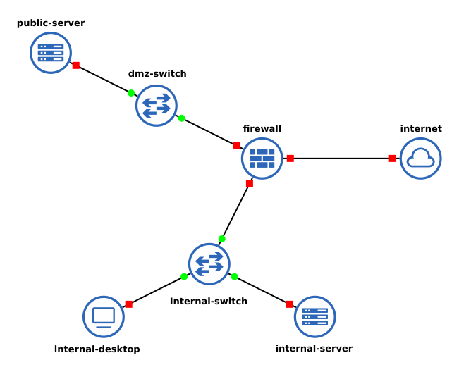

**Structure réseau :**

- **dmz-switch**
    - e0 ←→ eth2 firewall
    - e1 ←→ eth0 public-server

- **firewall**
    - eth0 ←→ e0 internal-switch
    - eth1 ←→ e0 internal-switch
    - eth2 ←→ e1 dmz-switch

- **internal-desktop**
    - eth0 ←→ e1 internal-switch

- **internal-server**
    - eth0 ←→ e2 internal-switch

- **internal-switch**
    - e0 ←→ eth1 firewall
    - e1 ←→ eth0 internal-desktop
    - e2 ←→ eth0 internal-server

- **internet**
    - eth0 ←→ eth0 firewall

- **public-server**
    - eth0 ←→ e1 dmz-switch

###### Image de la liaison des noeuds :

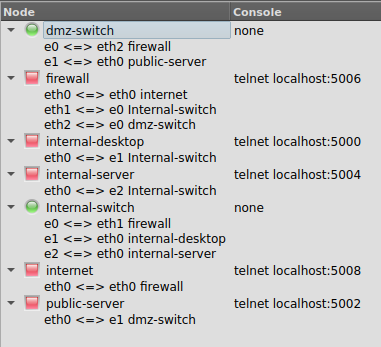

##### 2. Démarrage et configuration des adresses IP

Après le démarrage de toutes les instances, on configure leurs adresses IP comme suit :

###### a) LAN

- **internal-desktop**
  ```bash
  ip a add 19.4.3.1/29 dev eth0
  ip route add default via 19.4.3.3 dev eth0
  echo "nameserver 19.4.3.3" > /etc/resolv.conf
  ```
- **internal-server**
  ```bash
  ip a add 19.4.3.2/29 dev eth0
  ip route add default via 19.4.3.3 dev eth0
  echo "nameserver 19.4.3.3" > /etc/resolv.conf
  ```

###### b) WAN

- **internet**
  ```bash
  ip a add 19.4.3.17/29 dev eth0
  ip route add default via 19.4.3.18 dev eth0
  ```

###### c) DMZ

- **public-server (DMZ)**
  ```bash
  ip a add 19.4.3.9/29 dev eth0
  ip route add default via 19.4.3.11 dev eth0
  ```

###### d) Pare-feu

- **firewall**
  ```bash
  ip a add 19.4.3.3/29 dev eth1
  ip a add 19.4.3.11/29 dev eth2
  ip a add 19.4.3.18/29 dev eth0
  sysctl -w net.ipv4.ip_forward=1
  ```

###### Subnets utilisés

```bash
WAN="19.4.3.16/29"
LAN="19.4.3.0/29"
DMZ="19.4.3.8/29"
```

###### Image de la topologie :

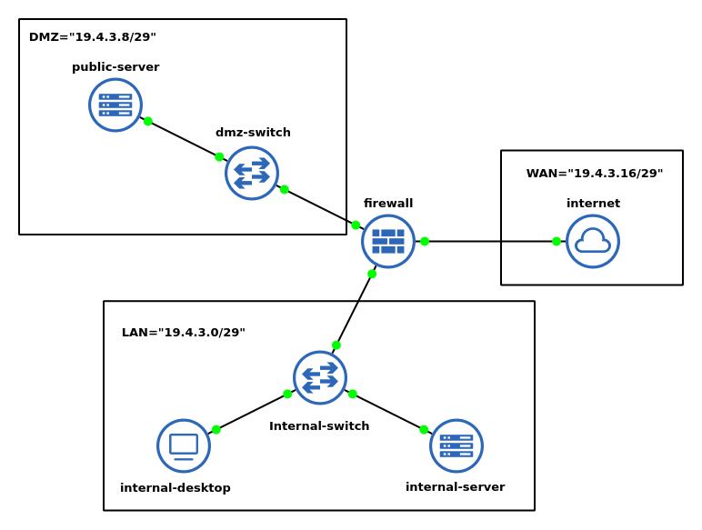

#### 3. Configuration des servers

###### 3.1 public-server

 ```bash
echo "ServerName localhost" | tee /etc/apache2/conf-available/servername.conf
a2enconf servername
service apache2 restart

cd /var/www/html/

echo "<html>
<head>
    <title>Serveur Apache dans Docker DMZ</title>
</head>
<body>
    <h1>Bienvenue sur le serveur publique</h1>
</body>
</html>" > /var/www/html/index.html

a2enmod ssl
a2enmod rewrite

mkdir -p /etc/ssl/private
mkdir -p /etc/ssl/certs

openssl req -x509 -nodes -days 365 -newkey rsa:2048 \
    -keyout /etc/ssl/private/apache-selfsigned.key \
    -out /etc/ssl/certs/apache-selfsigned.crt \
    -subj "/C=FR/ST=State/L=City/O=Organization/OU=OrgUnit/CN=webserver"

cat > /etc/apache2/sites-available/default-ssl.conf << 'EOF'
<IfModule mod_ssl.c>
    <VirtualHost *:443>
        DocumentRoot /var/www/html
        
        SSLEngine on
        SSLCertificateFile /etc/ssl/certs/apache-selfsigned.crt
        SSLCertificateKeyFile /etc/ssl/private/apache-selfsigned.key
        
        <FilesMatch "\.(cgi|shtml|phtml|php)$">
            SSLOptions +StdEnvVars
        </FilesMatch>
    </VirtualHost>
</IfModule>
EOF

a2ensite default-ssl

service apache2 restart

mkdir -p /var/run/sshd
ssh-keygen -A
echo "PasswordAuthentication yes" >> /etc/ssh/sshd_config
echo "PermitRootLogin yes" >> /etc/ssh/sshd_config
useradd -m -s /bin/bash user
echo "user:root" | chpasswd
service ssh start

  ```

###### 3.2 internal-server

 ```bash
  echo "ServerName localhost" | tee /etc/apache2/conf-available/servername.conf
  a2enconf servername
  service apache2 restart

  cd /var/www/html/

  echo "<html>
  <head>
      <title>Serveur Apache dans Docker Interne</title>
  </head>
  <body>
      <h1>Bienvenue sur le serveur interne</h1>
  </body>
  </html>" > /var/www/html/index.html

  ```

###### 3.3 internet

```bash
echo "ServerName localhost" | tee /etc/apache2/conf-available/servername.conf
a2enconf servername
service apache2 restart

cd /var/www/html/

echo "<html>
<head>
    <title>Mon serveur Apache dans Docker du WAN</title>
</head>
<body>
    <h1>Bienvenue sur le WAN</h1>
</body>
</html>" > /var/www/html/index.html

```

### 3.  **Configuration des services et comportements attendus**

#### 3.1. **Pare-feu**

On definit tout d'abord les varables à utiliser :

 ```bash
  WAN="19.4.3.16/29"
  LAN="19.4.3.0/29"
  DMZ="19.4.3.8/29"
  HTTP="80"
  HTTPS="443"
  SSH="22"

  WAN_IFACE="eth0"
  LAN_IFACE="eth1"
  DMZ_IFACE="eth2"
  ```

Etant donné qu'on a crée l'image docker à partir d'une image **ubuntu vierge** et qu'on a **nous meme installé les
packets necessaires**, **``iptables`` ne contient encore aucune regle**.

##### - Autoriser HTTP, HTTPS, SSH vers la DMZ (depuis WAN et LAN)

 ```bash
  iptables -A FORWARD -p tcp -s $LAN,$WAN -d $DMZ -m multiport --dports $HTTP,$HTTPS,$SSH -m conntrack --ctstate NEW,ESTABLISHED,RELATED -j ACCEPT
  iptables -A FORWARD -s $DMZ -d $LAN,$WAN -m conntrack --ctstate ESTABLISHED,RELATED -j ACCEPT
  ```

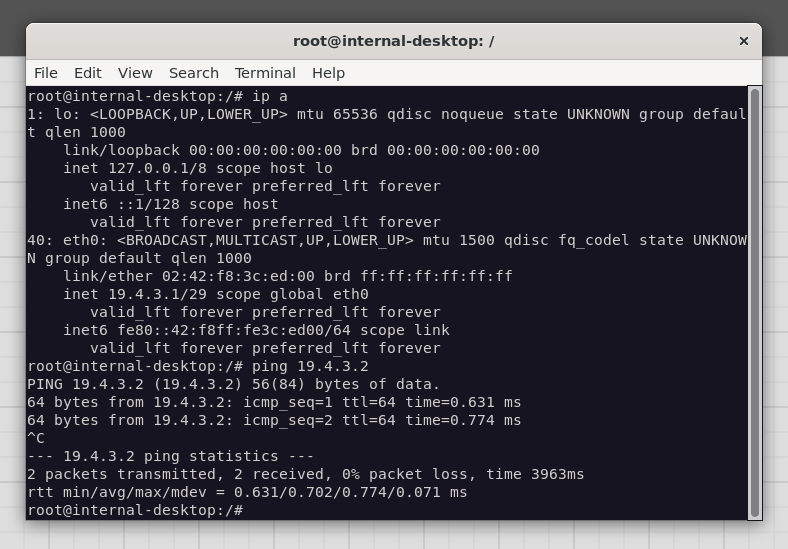

##### - Bloquer tout autre port ou protocole par défaut

 ```bash
  iptables -P FORWARD DROP
  ```

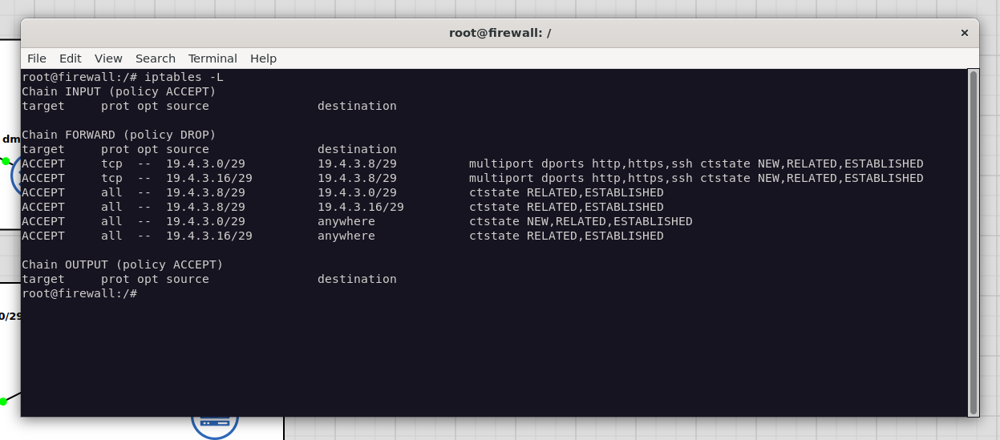

##### - Bloquer l’accès du WAN vers le LAN

Déja inclut avec :

 ```bash
  iptables -P FORWARD DROP
  ```

curl du server LAN local vers lui meme :
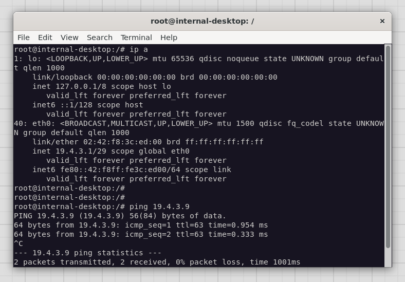

curl depuis le WAN vers me server LAN local :
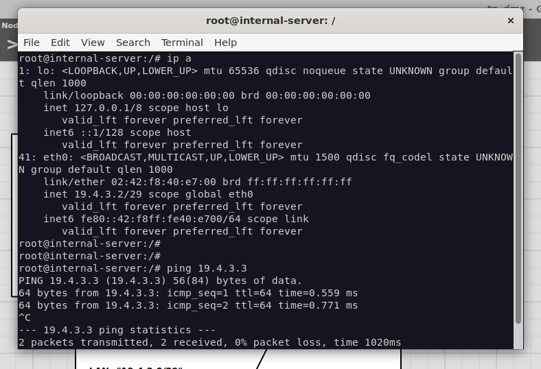

##### - Autoriser le LAN à sortir vers l’extérieur via NAT

 ```bash
  iptables -t nat -A POSTROUTING -s $LAN -o $WAN_IFACE -j MASQUERADE
  iptables -A FORWARD -s $LAN -o $WAN_IFACE -m conntrack --ctstate NEW,ESTABLISHED,RELATED -j ACCEPT
  iptables -A FORWARD -s $WAN -i $WAN_IFACE -m conntrack --ctstate ESTABLISHED,RELATED -j ACCEPT
  ```

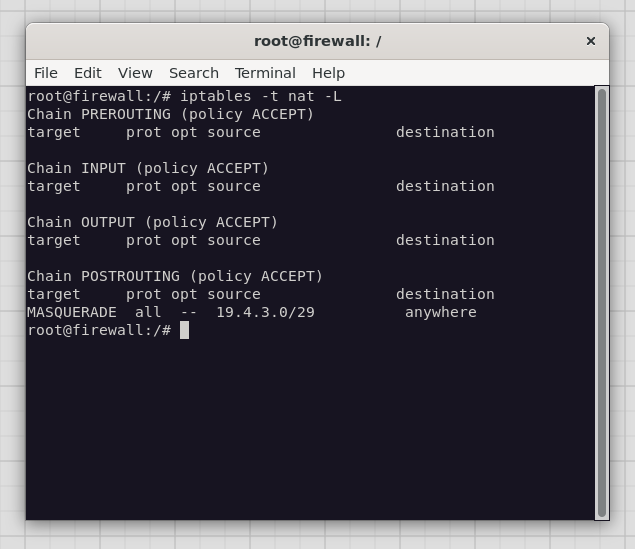

- ping depuis LAN vers WAN :
    - 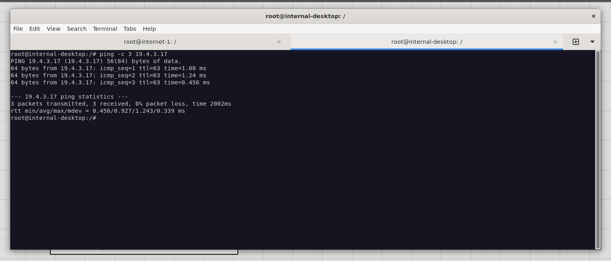
- affichage des packets dans internet :
    - 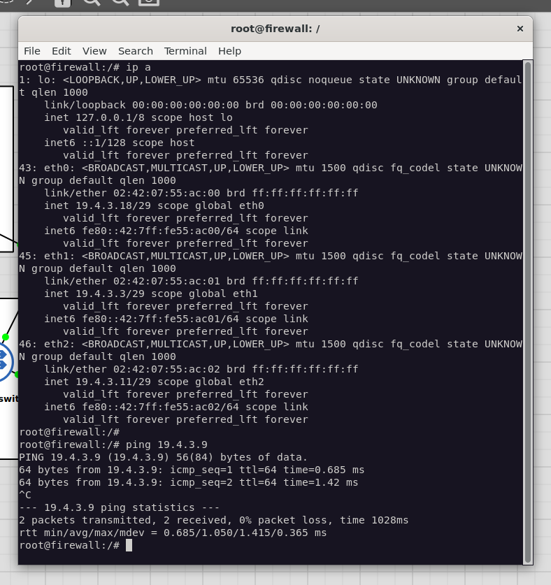

##### - Mise en place d'un serveur DNS (Dnsmasq)

Pour simplifier la résolution de noms dans notre topologie, nous allons configurer `dnsmasq` sur le pare-feu. Ce service
agira comme un serveur DNS pour le LAN, résolvant les noms de domaine de notre réseau local et transférant les autres
requêtes à des serveurs DNS externes (simulés ou réels).

###### 1. Configuration de Dnsmasq

Créez un fichier de configuration pour `dnsmasq` sur le pare-feu. Nous allons le configurer pour qu'il écoute uniquement
sur l'interface du LAN et utilise le fichier `/etc/hosts` du pare-feu comme source pour les noms locaux.

```bash
# Sur le pare-feu
cat > /etc/dnsmasq.conf << 'EOF'
interface=eth1
no-resolv
server=8.8.8.8
expand-hosts
domain=lan.local
EOF
```

###### 2. Ajout d'entrées DNS locales

Pour que notre test de filtrage fonctionne sans modifier le fichier `/etc/hosts` de chaque client, nous pouvons ajouter
l'entrée directement dans le fichier `/etc/hosts` du pare-feu. `dnsmasq` le servira ensuite à tout le LAN.

```bash
# Sur le pare-feu
echo "19.4.3.17 pornhub.com" >> /etc/hosts
```

###### 3. Démarrage du service

```bash
# Sur le pare-feu
service dnsmasq start
```

###### 4. Configuration des clients DNS

Nous avons déjà mis à jour la configuration des machines du LAN à l'étape 2.2 pour qu'elles utilisent le pare-feu (
`19.4.3.3`) comme serveur DNS.

###### 5. Test de la résolution DNS

Depuis `internal-desktop`, vous pouvez maintenant utiliser `nslookup` ou `dig` pour vérifier que la résolution de noms
fonctionne.

```bash
# Sur internal-desktop
nslookup pornhub.com
```

La réponse devrait être `19.4.3.17`.

##### - Bloquer les sites pornographiques (SquidGuard)

Pour bloquer l'accès à des sites spécifiques, nous utiliserons Squid comme proxy transparent et SquidGuard comme filtre
d'URL. Le trafic HTTP du LAN sera redirigé vers Squid, qui le passera à SquidGuard pour inspection.

###### 1. Création d'un fichier de configuration personnalisé pour Squid

Pour éviter les conflits avec la configuration par défaut, nous allons créer un fichier séparé qui contiendra nos
directives. Squid lira ce fichier et appliquera nos règles.

Créez le fichier `/etc/squid/conf.d/00-custom.conf` sur le pare-feu :

```bash
cat >/etc/squid/conf.d/00-custom.conf<< 'EOF'
http_port 3128 intercept

http_port 127.0.0.1:3129

acl localnet src 19.4.3.0/29

http_access allow localnet

url_rewrite_program /usr/bin/squidGuard -c /etc/squidguard/squidGuard.conf

url_rewrite_children 5
EOF
```

###### 2. Configuration de SquidGuard

Créez et configurez le fichier `/etc/squidguard/squidGuard.conf` pour définir les listes de blocage.

```bash
cat >/etc/squidguard/squidGuard.conf<< 'EOF'
dbhome /var/lib/squidguard/db

logdir /var/log/squid

src lan {
    ip 19.4.3.0/29
}

dest porn {
    domainlist porn/domains
    urllist porn/urls
}

acl {
    lan {
        pass !porn all
        redirect http://19.4.3.3/cgi-bin/squidGuard.cgi?clientaddr=%a&clientname=%n&clientuser=%i&clientgroup=%s&targetgroup=%t&url=%u
    }
    default {
        pass none
        redirect http://19.4.3.3/cgi-bin/squidGuard.cgi?clientaddr=%a&clientname=%n&clientuser=%i&clientgroup=%s&targetgroup=%t&url=%u
    }
}
EOF
```

###### 3. Création de la liste noire

Nous devons créer les fichiers contenant les domaines et URL à bloquer.

```bash
mkdir -p /var/lib/squidguard/db/porn

cat > /var/lib/squidguard/db/porn/domains << 'EOF'
pornhub.com
xvideos.com
xnxx.com
redtube.com
youporn.com
EOF

touch /var/lib/squidguard/db/porn/urls
```

###### 4. Redirection du trafic avec iptables

Ajoutez une règle `iptables` sur le pare-feu pour rediriger tout le trafic HTTP (port 80) provenant du LAN vers le port
de Squid (3128).

Rediriger le trafic HTTP du LAN vers Squid

```bash
iptables -t nat -A PREROUTING -i $LAN_IFACE -p tcp --dport 80 -j REDIRECT --to-port 3128
```

###### 5. Finalisation de la configuration

Compilez la base de données de SquidGuard, ajustez les permissions et redémarrez les services.

```bash
squidGuard -b -d -C all

chown -R proxy:proxy /var/lib/squidguard/db
chown -R proxy:proxy /var/log/squid
chmod -R 755 /var/lib/squidguard/db

service squid restart
```

###### 5.1 Vérification de la configuration

Avant de redémarrer Squid, il est crucial de vérifier que les fichiers de configuration ne contiennent pas d'erreurs de
syntaxe.

```bash
squid -k parse
```

Si cette commande ne retourne aucune erreur, vous pouvez continuer. Sinon, vous devrez corriger les erreurs indiquées
dans `squid.conf` avant de poursuivre.

###### 5.2 Vérification de SquidGuard

Si la configuration de Squid est valide mais que le service ne démarre toujours pas, le problème vient probablement de
SquidGuard.

```bash
chown -R proxy:proxy /var/lib/squidguard/db
chmod -R 755 /var/lib/squidguard/db

squidGuard -b -d -C all
```

###### 6. Test du filtrage

Dans notre topologie simulée, les machines du LAN n'ont pas accès à un serveur DNS public pour résoudre les noms de
domaine comme `pornhub.com`. Pour pouvoir tester notre configuration, nous avons deja utilisé `dnsmasq`.
Il ne nous reste plus qu'à executer la commande :

```bash
curl http://pornhub.com
```

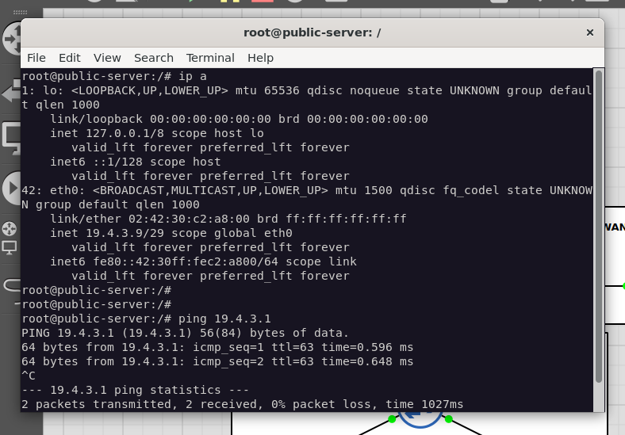

##### - Bloquer les réseaux sociaux pendant les heures de travail

Nous utiliserons la fonctionnalité de gestion du temps de SquidGuard.

###### 1. Mise à jour de la configuration de SquidGuard

Modifiez le fichier `/etc/squidguard/squidGuard.conf` pour y inclure une définition des plages horaires et une nouvelle
catégorie de sites à bloquer ("social"). La section `acl` est également mise à jour pour appliquer des règles
différentes en fonction de l'heure.

Le nouveau contenu complet du fichier de configuration est le suivant :

```bash
cat >/etc/squidguard/squidGuard.conf<< 'EOF'
dbhome /var/lib/squidguard/db

logdir /var/log/squid

src lan {
    ip 19.4.3.0/29
}

time workhours {
    weekly mtwhf 08:00-12:00
    weekly mtwhf 14:00-18:00
}

dest porn {
    domainlist porn/domains
    urllist porn/urls
}

dest social {
    domainlist social/domains
    urllist social/urls
}

acl {
    lan within workhours {
        pass !porn !social all
        redirect http://19.4.3.3/cgi-bin/squidGuard.cgi?clientaddr=%a&clientname=%n&clientuser=%i&clientgroup=%s&targetgroup=%t&url=%u
    }

    lan {
        pass !porn all
        redirect http://19.4.3.3/cgi-bin/squidGuard.cgi?clientaddr=%a&clientname=%n&clientuser=%i&clientgroup=%s&targetgroup=%t&url=%u
    }

    default {
        pass none
        redirect http://19.4.3.3/cgi-bin/squidGuard.cgi?clientaddr=%a&clientname=%n&clientuser=%i&clientgroup=%s&targetgroup=%t&url=%u
    }
}
EOF
```

###### 2. Création de la liste noire des réseaux sociaux

Ajoutez la liste des domaines de réseaux sociaux à bloquer.

Créer le répertoire et la liste pour les réseaux sociaux, lister les domaines et creer le fichier contenant les urls (
pour ne pas avoir d'erreur lors de la verofocation du ficher de configuration)

```bash
mkdir -p /var/lib/squidguard/db/social

cat > /var/lib/squidguard/db/social/domains << 'EOF'
facebook.com
twitter.com
instagram.com
tiktok.com
linkedin.com
snapchat.com
pinterest.com
EOF

touch /var/lib/squidguard/db/social/urls
```

###### 3. Finalisation et Test

Après avoir modifié la configuration et ajouté la nouvelle liste, vous devez recompiler la base de données de SquidGuard
et redémarrer le service, comme à l'étape 5.

Compiler la base de données (inclut maintenant la liste "social"), s'assurer que les permissions sont correctes et
redemarrer squid

```bash
squidGuard -b -d -C all

chown -R proxy:proxy /var/lib/squidguard/db
chmod -R 755 /var/lib/squidguard/db

service squid restart
```

Pour tester, ajoutez les domaines des réseaux sociaux au fichier `/etc/hosts` du pare-feu (pour que `dnsmasq` les
résolve), puis essayez d'y accéder depuis `internal-desktop` avec `curl`.

```bash
# Sur le pare-feu
echo "19.4.3.17 facebook.com" >> /etc/hosts
echo "19.4.3.17 twitter.com" >> /etc/hosts

service dnsmasq restart

# Sur internal-desktop, pendant les heures de travail
curl http://facebook.com 
```

curl depuis le LAN vers facebook à 13h :
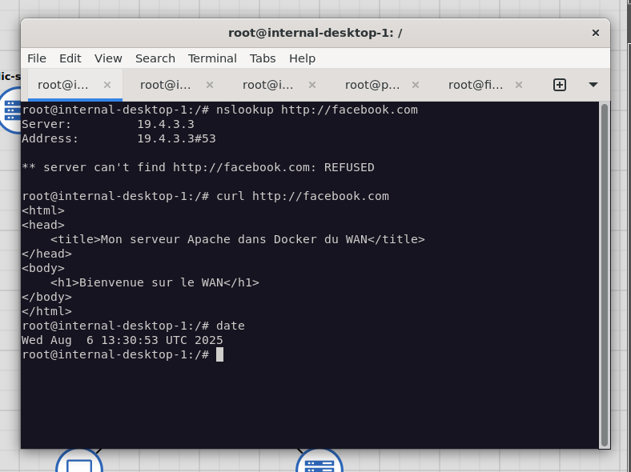

configuration de l'heure de travail à 13h pour le test :
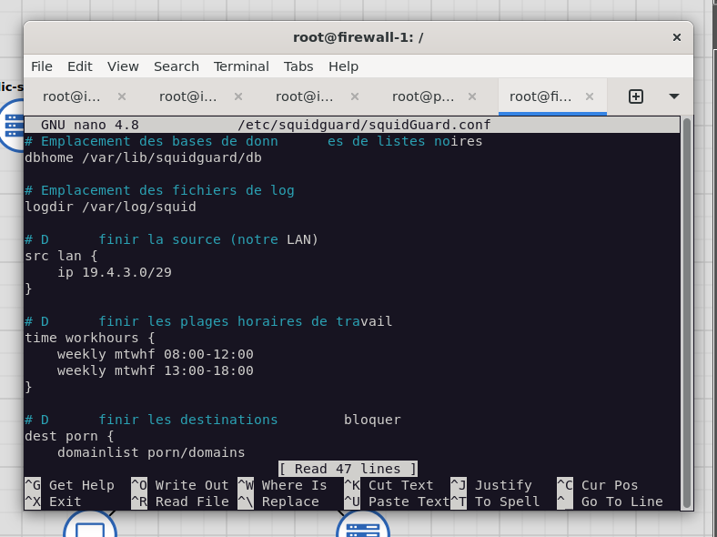

curl depuis le LAN vers facebook à durant les heures de travail:
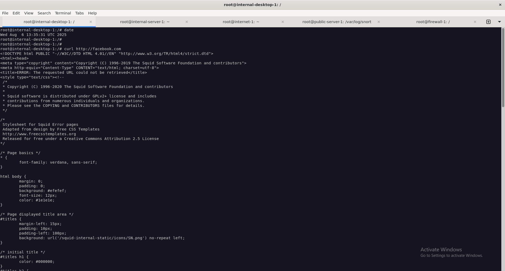

##### - Limiter la bande passante avec iptables

Pour garantir une utilisation équitable des ressources réseau, nous allons mettre en place une politique de Qualité de
Service (QoS) pour limiter la bande passante de chaque machine du LAN à 500 Ko/s. Nous utiliserons le module `hashlimit`
d'iptables.

Le module `hashlimit` permet de créer des règles basées sur un taux de paquets ou de données, par adresse IP.

###### 1. Application de la limitation de bande passante

Sur le pare-feu, nous allons ajouter deux règles à la chaîne `FORWARD` : une pour le trafic sortant (upload) et une pour
le trafic entrant (download).

- **Limite** : 500 Ko/s, ce qui équivaut à `500kb/s` pour `iptables`.
- **Mode** : Nous utilisons `--hashlimit-mode srcip` pour le trafic sortant (limiter chaque machine du LAN) et
  `--hashlimit-mode dstip` pour le trafic entrant.

```bash
# Sur le pare-feu

iptables -A FORWARD -s $LAN -o $WAN_IFACE -m hashlimit --hashlimit-name lan_upload --hashlimit-mode srcip --hashlimit-above 500kb/s -j DROP

iptables -A FORWARD -d $LAN -i $WAN_IFACE -m hashlimit --hashlimit-name lan_download --hashlimit-mode dstip --hashlimit-above 500kb/s -j DROP
```

Ces règles garantissent que ni l'upload ni le download ne dépassent 500 Ko/s pour chaque machine du réseau local.

###### 2. Vérification et Test

Pour vérifier que les règles sont actives, vous pouvez lister les règles de la chaîne `FORWARD` :

```bash
iptables -L FORWARD -v -n
```

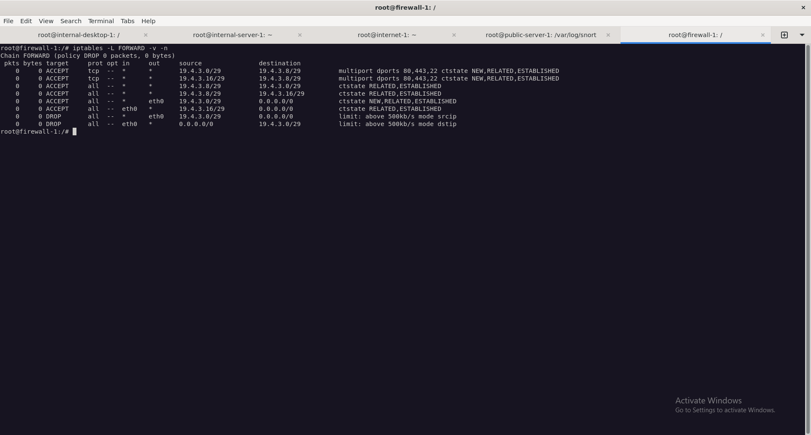

Pour tester la limitation, vous pouvez générer un fichier volumineux sur le serveur `internet` et le télécharger depuis
une machine du LAN en utilisant `wget`.

```bash
# Sur le serveur 'internet'
dd if=/dev/zero of=/var/www/html/largefile.img bs=1M count=100

# Sur 'internal-desktop'
wget http://19.4.3.17/largefile.img
```

`wget` affichera la vitesse de téléchargement, qui devrait être plafonnée aux alentours de 500 KB/s.
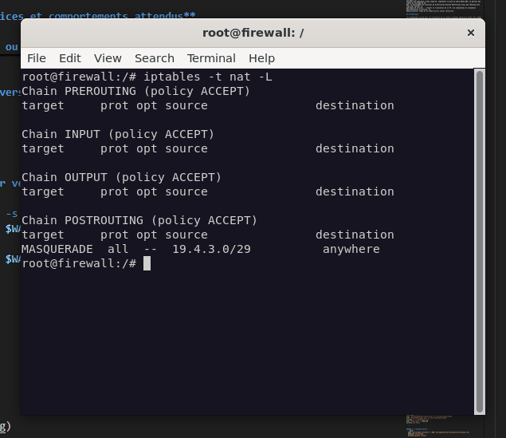

#### 3.2. **DMZ**

**Accessible en HTTP/HTTPS depuis WAN et LAN** et **Ne peut initier aucune connexion sortante** sont déjaà realisés avec
la configuration du pare-feu

- LAN -> DMZ
    - 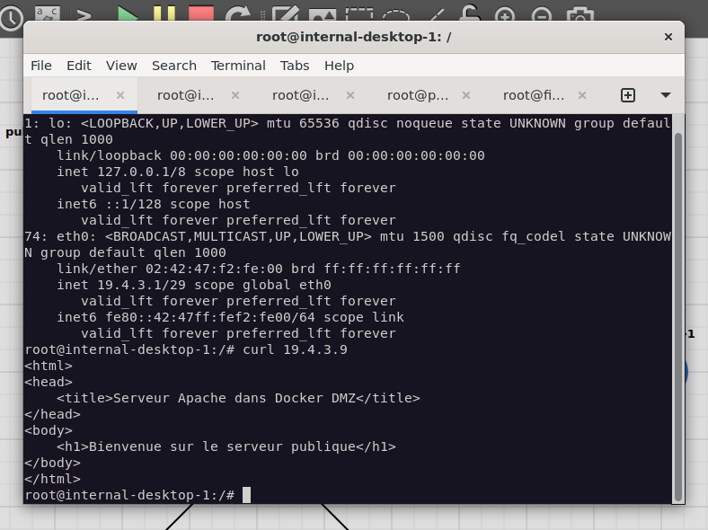

- WAN -> DMZ
    - 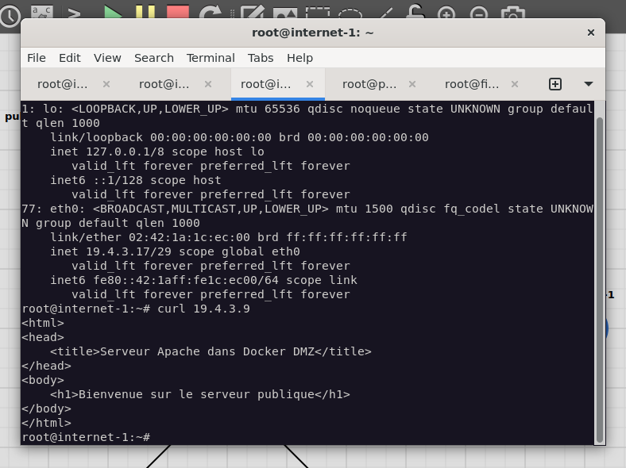

#### 3.3. **Surveillance IDS avec Snort**

##### Detecter et journaliser les tentatives d'attaque et de scan

###### 1. Configuration de base de Snort

On commence par faire un backup du fichier de configuration principal de snort

```bash
cp /etc/snort/snort.conf /etc/snort/snort.conf.bak
```

Nous allons configurer Snort pour qu'il détecte et journalise les tentatives d'attaque et de scan sur notre serveur
DMZ (19.4.3.9).

###### 2. Modification des variables réseau

D'abord, nous modifions les variables de réseau dans snort.conf pour cibler spécifiquement notre serveur DMZ:

```bash
# Dans /etc/snort/snort.conf
ipvar HOME_NET 19.4.3.9
ipvar EXTERNAL_NET !$HOME_NET
```

###### 3. Création de règles de détection personnalisées

Nous créons ensuite un fichier de règles local pour détecter différents types d'attaques:

```bash
# Créer le fichier local.rules
cat > /etc/snort/rules/local.rules << 'EOF'

# ==== SCANS DE PORT ====
alert tcp any any -> $HOME_NET any (msg:"[SCAN] TCP SYN scan détecté"; flags:S,12; threshold:type threshold, track by_src, count 5, seconds 60; classtype:attempted-recon; sid:2000001; rev:1;)

alert tcp any any -> $HOME_NET any (msg:"[SCAN] TCP Connect scan détecté"; flags:S; threshold:type threshold, track by_src, count 10, seconds 60; classtype:attempted-recon; sid:2000002; rev:1;)

alert udp any any -> $HOME_NET any (msg:"[SCAN] UDP scan détecté"; threshold:type threshold, track by_src, count 15, seconds 60; classtype:attempted-recon; sid:2000003; rev:1;)

# ==== ATTAQUES DoS ====
alert icmp any any -> $HOME_NET any (msg:"[DoS] Attaque ICMP flood détectée"; threshold:type threshold, track by_src, count 30, seconds 10; classtype:attempted-dos; sid:2000010; rev:1;)

alert tcp any any -> $HOME_NET any (msg:"[DoS] Attaque SYN flood détectée"; flags:S,12; flow:stateless; threshold:type threshold, track by_src, count 50, seconds 10; classtype:attempted-dos; sid:2000011; rev:1;)

# ==== ATTAQUES WEB ====
alert tcp any any -> $HOME_NET 80 (msg:"[WEB] Possible injection SQL détectée"; content:"UNION SELECT"; nocase; classtype:web-application-attack; sid:2000020; rev:1;)

alert tcp any any -> $HOME_NET 80 (msg:"[WEB] Possible attaque XSS détectée"; content:"<script>"; nocase; classtype:web-application-attack; sid:2000022; rev:1;)
EOF
```

###### 4. Configuration de la journalisation

Pour assurer un suivi complet des attaques détectées, nous configurons plusieurs formats de journalisation dans
snort.conf:

```bash
# Dans /etc/snort/snort.conf
output unified2: filename snort.log, limit 128, nostamp, mpls_event_types, vlan_event_types
output log_tcpdump: /var/log/snort/tcpdump.log
output alert_fast: /var/log/snort/alert.fast
output alert_csv: /var/log/snort/alert.csv default
```

###### 5. Démarrage de Snort avec la nouvelle configuration

Enfin, nous démarrons Snort avec la configuration mise à jour:

```bash
# Créer le répertoire pour les logs
mkdir -p /var/log/snort/

snort -A console -q -u snort -g snort -c /etc/snort/snort.conf -l /var/log/snort/ -i eth0

```

- nmap depuis internet vers la DMZ
    - 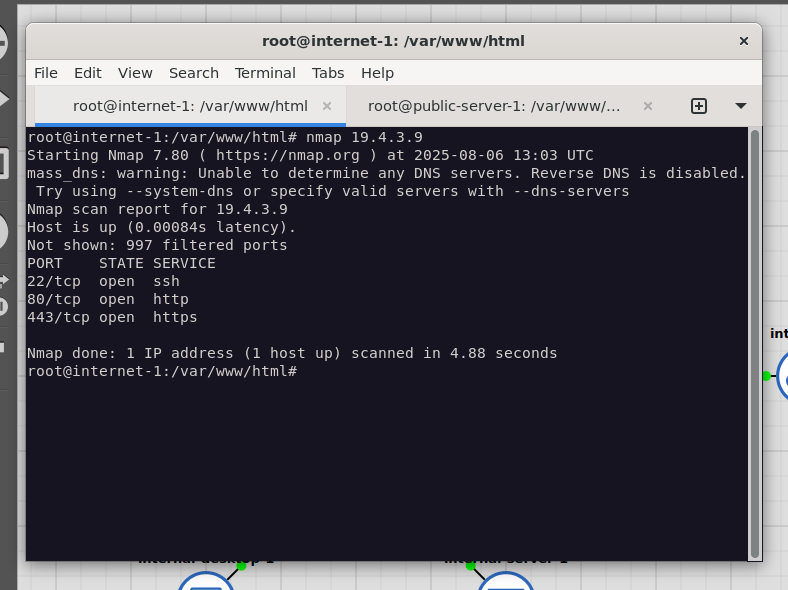
- detection de nmap par snort dans la DMZ
    - 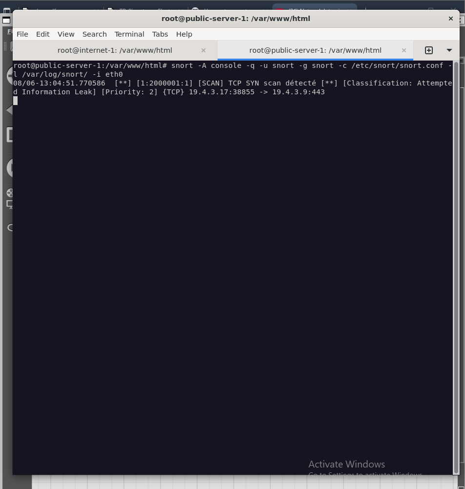
- log snort pour les scans de nmap
    - 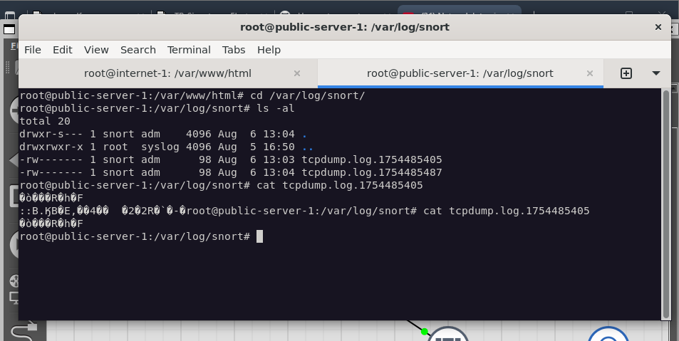
